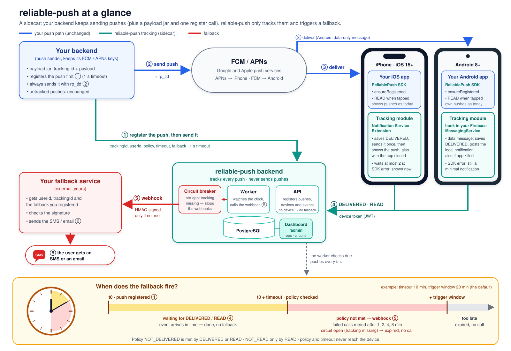
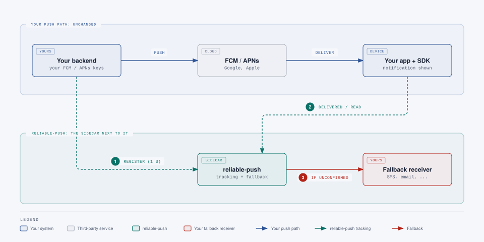

# reliable-push

[](LICENSE)

reliable-push is an MIT-licensed add-on for teams that already send push
notifications through FCM or APNs. It tracks whether each push was **delivered**
and **read** on the device and, if a per-notification policy is not satisfied
within N minutes, triggers a **fallback** by calling a configurable, HMAC-signed
webhook (`userId`, message, `trackingId`) that routes to SMS, email or any other
channel. It runs as a sidecar: your existing backend keeps sending pushes itself
and keeps the FCM/APNs credentials.



The backend also serves an **ops dashboard** at `/admin/` (delivery and read rates, the due backlog, daily trends,
search, a timeline per notification and each app's fallback circuit), off until you configure an admin key:
[docs/admin.md](docs/admin.md). It is read-only except "Resume fallbacks" for keys with the `fallback-control` permission.

## A sidecar, not a push gateway

reliable-push sits **next to** your push path, not on it. The backend and the mobile SDKs only observe and react, so
they never change how your notifications are sent or shown:

- **Your backend keeps sending the pushes** with its own FCM / APNs credentials. reliable-push never sends a push and
  never sees those credentials.
- **If the reliable-push backend is down, your pushes still go out.** Only tracking and fallbacks pause. Device events
  wait in the SDK's queue and are sent when the backend is back. If only the tracking side fails (API or ingress down,
  an SDK bug), a per-app **circuit breaker** stops the fallbacks instead of sending an SMS for every push of that period.
- **Tracking never blocks a notification.** Pushes without `rp_tid` are left to your own code. The receive path makes
  one network call and never renews tokens; the iOS extension hands the notification back within a bounded timeout
  (2 s by default), and on Android, where the SDK posts tracked notifications itself (data messages, the market-standard
  model), any SDK error still ends in a posted notification. Errors stay inside the SDK and never reach the app.



What happens when each part fails, the component diagrams and the full lifecycle: [docs/overview.md](docs/overview.md).
To present the project, open [docs/presentation.html](docs/presentation.html) in a browser.

## How it works

1. Your backend generates a `trackingId` and builds the payload with the optional payload jar
   (`reliable-push-payload`, Java 8+, zero dependencies), then registers the notification with
   `POST /v1/notifications` (`trackingId`, `userId`, message, policy) using an `X-Api-Key`, with a short timeout.
2. Your backend sends the push through FCM/APNs itself, with the `trackingId` as `rp_tid`, whatever the registration
   answered. Android pushes are data-only messages; the SDK shows them. Users without a registered device get no
   tracking and no fallback (`NO_DEVICE_REGISTERED`).
3. The device SDK (iOS Notification Service Extension / Android FCM service)
   reports `DELIVERED` to `POST /v1/events` with its device JWT. The app keeps the device registered with
   `ensureRegistered`, the only place where the token is renewed.
4. When the user taps the notification, the SDK reports `READ`.
5. The reliable-push worker periodically claims notifications that are due and
   whose policy is still unmet, and calls your fallback webhook with a signed
   request (`trackingId`, `userId`, message, `reason`).
6. Before claiming, it checks each app's fallback circuit: when an app's fallbacks come due while almost none of its
   notifications were reported delivered (tracking is missing), it closes them as `FALLBACK_EXPIRED` without a call until
   deliveries are reported again ([docs/operations.md](docs/operations.md#fallback-circuit-breaker)).

## Components

| Path | What | Stack |
|---|---|---|
| `backend/` | Tracking + fallback service (modular monolith, `api`/`worker` profiles) | Java 21, Spring Boot 4, PostgreSQL, Flyway |
| `android/` | Android SDK, FCM v1 data mode ([guide](docs/android.md); the AndroidConfigV2 mode waits for Google's GA) | Kotlin, minSdk 26 |
| `ios/` (+ root `Package.swift`) | iOS SDK + Notification Service Extension helper ([guide](docs/ios.md)) | Swift, iOS 15+, SPM |
| `client-java/` | Optional zero-dependency Java client for the sender API | Java 17+, JDK only |
| `payload-java/` | Optional zero-dependency payload jar: tracking ids, tracked APNs and FCM payloads, golden vectors for other languages ([README](payload-java/README.md)) | Java 8+, JDK only |
| `harness/` | Fake sender, fake fallback receiver, device simulator, E2E scenarios, web console for manual tests and demos | Java, plain HTML/JS, docker-compose |
| `deploy/helm/` | Helm chart for the backend (combined or split API/worker, GKE and OpenShift values) | Helm, Kubernetes ≥ 1.30 |
| `loadtest/` | Local load tests (NFR-2 ingest, fallback burst) run by `./scripts/load.sh` | Java 21, Gatling, docker-compose |
| `docs/` | Requirements, specs, plans, guides, status | Markdown |

The latest release is `v0.2.0` (ops dashboard, fallback circuit breaker, sidecar integration revision with the payload
jar; [CHANGELOG.md](CHANGELOG.md)). What is left is in
[docs/TODO.md](docs/TODO.md), and the session log is in [docs/STATUS.md](docs/STATUS.md). To build, run and test each
component step by step, see [docs/getting-started.md](docs/getting-started.md).

### Try it: demo console

`./scripts/demo.sh` starts the whole stack locally (Docker only) and opens the harness web console at
<http://127.0.0.1:8090/>: create simulated devices, send pushes, watch delivery tracking and fallbacks live. Details in
[docs/testing.md](docs/testing.md#web-console-and-demo). The end-to-end suite is `./scripts/e2e.sh` (local only, never in CI).
Java sender client: [client-java/README.md](client-java/README.md); payload jar: [payload-java/README.md](payload-java/README.md).

## Quick start

Run the backend locally with Docker (no JDK needed for this path) and register your first notification. The values below
are placeholders generated on the spot with `openssl`; use your own secret management for anything real.

```sh
# 1. Build the image (a jlink-trimmed JRE image, about 105 MB)
docker build -t reliable-push-backend:dev backend

# 2. Secrets: sender API key (+ its SHA-256), webhook HMAC secret, database password, device-token signing key pair
#    (run steps 2-3 in a scratch directory: it receives k1.pem, k1.pub.pem and rp.yml, which must not be committed)
export RP_SENDER_KEY=$(openssl rand -hex 32)
export RP_SENDER_KEY_SHA256=$(printf '%s' "$RP_SENDER_KEY" | openssl dgst -sha256 -hex | sed 's/^.* //')
export RP_SHOP_HOOK_SECRET=$(openssl rand -hex 32)
export RP_DB_PASSWORD=$(openssl rand -hex 16)
openssl genpkey -algorithm EC -pkeyopt ec_paramgen_curve:P-256 -pkeyopt ec_param_enc:named_curve -out k1.pem
openssl pkey -in k1.pem -pubout -out k1.pub.pem

# 3. App configuration (placeholders: set your own identity provider and fallback receiver)
cat > rp.yml <<EOF
reliable-push:
  device-token:
    signing-keys:
      - kid: k1
        private-key-pem-ref: env:RP_DEVICE_KEY_K1
        public-key-pem-ref: env:RP_DEVICE_PUB_K1
    current-kid: k1
  apps:
    shop:
      sender-api-key-sha256: "${RP_SENDER_KEY_SHA256}"
      identity:
        type: oidc
        issuer: https://idp.example.com        # placeholder: your OIDC issuer
        audience: shop-mobile
      fallback:
        url: https://fallback.example.com/hook # placeholder: your fallback receiver
        hmac-secret-ref: env:RP_SHOP_HOOK_SECRET
EOF

# 4. PostgreSQL and the backend (Flyway creates the schema at startup)
docker network create rp-net
docker run -d --name rp-db --network rp-net -e POSTGRES_DB=reliablepush -e POSTGRES_USER=rp \
  -e POSTGRES_PASSWORD="$RP_DB_PASSWORD" postgres:16
# wait for PostgreSQL (--restart below covers its init restart)
until docker exec rp-db pg_isready -U rp -d reliablepush >/dev/null 2>&1; do sleep 1; done
docker run -d --name rp-app --network rp-net --restart on-failure -p 8080:8080 \
  -v "$PWD/rp.yml:/config/application.yml:ro" -e SPRING_CONFIG_ADDITIONAL_LOCATION=optional:file:/config/ \
  -e SPRING_DATASOURCE_URL=jdbc:postgresql://rp-db:5432/reliablepush \
  -e SPRING_DATASOURCE_USERNAME=rp -e SPRING_DATASOURCE_PASSWORD="$RP_DB_PASSWORD" \
  -e RP_SHOP_HOOK_SECRET -e RP_DEVICE_KEY_K1="$(cat k1.pem)" -e RP_DEVICE_PUB_K1="$(cat k1.pub.pem)" \
  reliable-push-backend:dev

# 5. Check health, then register a notification with a tracking id you generate
curl -s http://localhost:8080/actuator/health/readiness
TID=$(uuidgen | tr 'A-Z' 'a-z')
curl -s -X POST http://localhost:8080/v1/notifications \
  -H "X-Api-Key: $RP_SENDER_KEY" -H 'Content-Type: application/json' \
  -d '{"trackingId":"'"$TID"'","userId":"user-42","policy":"NOT_READ","timeoutMinutes":10,
       "fallback":{"sms":"Your order has shipped."}}'
# => 201 {"trackingId":"...","state":"NO_DEVICE_REGISTERED", ...}   (user-42 has no registered device yet)
```

`user-42` has no registered device, so the notification is stored closed as `NO_DEVICE_REGISTERED`: no tracking, no
fallback. Once an app with the SDK registers a device for the user, registrations are `PENDING` and the worker calls the
fallback receiver when the policy is still unmet at `dueAt` (with the placeholder URL above the call fails and is
retried, which you can watch in the JSON logs with `docker logs rp-app`). Send the push with `rp_tid` = the tracking id
(the payload jar builds it) and implement the receiver that verifies the `X-RP-Signature`: see the
[integration guide](docs/integration-guide.md); to see the whole flow without a phone, run the demo console above.
Cleanup: `docker rm -f rp-app rp-db && docker network rm rp-net`.

Building from source needs JDK 21 and Docker: `cd backend && ./mvnw -B verify` (tests) and
`./mvnw -B verify -Pimage` (image tests); `client-java`, `payload-java` and `harness` build from the repo root with
`./mvnw -B -pl client-java verify`, `./mvnw -B -pl payload-java verify` and `./mvnw -B -pl harness -am verify`. See
[docs/testing.md](docs/testing.md). All configuration keys, the log format and the metrics are in
[docs/operations.md](docs/operations.md).

## Documentation

- [System overview with diagrams](docs/overview.md)
- [Presentation (HTML slides)](docs/presentation.html)
- [Getting started: run and test each component](docs/getting-started.md)
- [Requirements](docs/requirements.md)
- [Design spec](docs/specs/2026-11-03-reliable-push-design.md)
- [Architecture](docs/architecture.md)
- [API reference](docs/api.md)
- [Integration guide](docs/integration-guide.md)
- [Ops dashboard](docs/admin.md)
- [Security](docs/security.md)
- [Operations](docs/operations.md)
- [Deployment (Kubernetes, GKE, OpenShift)](docs/deployment.md)
- [Testing](docs/testing.md)
- [Project status](docs/STATUS.md)
- [Remaining work (TODO)](docs/TODO.md)
- [Changelog](CHANGELOG.md)
- [AGENTS.md](AGENTS.md) (context for AI coding agents: the same for Claude Code and Antigravity, on macOS, Linux and
  Windows)
- [Contributing](CONTRIBUTING.md)
- [Security policy](SECURITY.md)
- [License](LICENSE)
