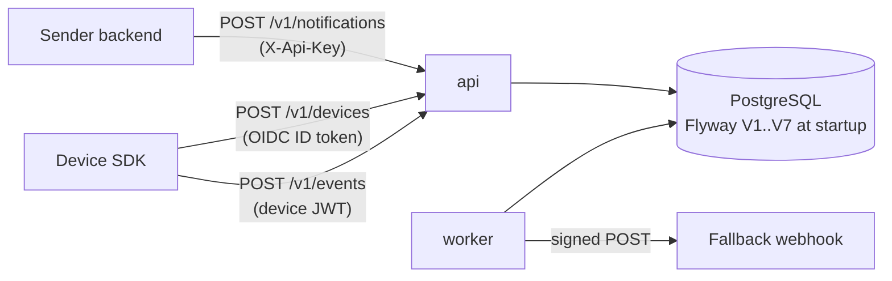
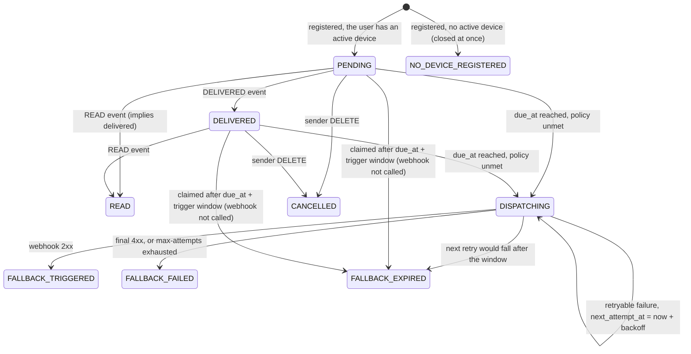

# Architecture

reliable-push is one Spring Boot application (a modular monolith) in one container image. PostgreSQL is its only
stateful dependency. The design spec ([`specs/2026-11-03-reliable-push-design.md`](specs/2026-11-03-reliable-push-design.md))
is the source of truth for decisions; this page explains how the backend implements them.

## Roles and profiles

Spring profiles select the background work of an instance:

| Profile | What it enables |
|---|---|
| `worker` | Fallback scheduler, webhook client, retention job, daily rollup job, due-backlog gauge |
| `api` | Marks an API-only instance (activate it without `worker`); the HTTP endpoints are served by every instance |
| `api,worker` (default when no profile is set) | Both |

The `json` / `local` profiles only switch the log layout; `e2e` and `demo` enable the fast clock. See
[operations.md](operations.md). Replicas of either role can be run side by side: coordination happens through
PostgreSQL row locks, not through any in-process state (rate limits and the revocation cache are per instance).



The backend is a sidecar: it never sends pushes and is not on the delivery path, so an outage pauses tracking and
fallbacks but not your notifications ([overview.md](overview.md#1-the-sidecar-principle)).

## Modules

Package `io.reliablepush`; modules call each other through public services only, never through another module's
repositories.

| Module | Responsibility | Entry points |
|---|---|---|
| `apps` | Typed `reliable-push.*` configuration, validated once at startup; per-app registry | `AppRegistry`, `ReliablePushProperties` |
| `notifications` | Sender API: register (idempotent per `externalId`), get, list, cancel; repository with all state transitions; retention and backlog jobs | `NotificationController`, `NotificationService`, `NotificationRepository`, `RetentionJob`, `DueBacklogJob` |
| `devices` | Device registration, device-token issue / refresh / revoke, signing keys, identity verification | `DeviceController`, `DeviceService`, `DeviceTokenService`, `SigningKeys`, `identity/*` |
| `tracking` | Device events to state transitions, per-item outcomes | `EventsController`, `TrackingService` |
| `fallback` | Claiming loop, trigger-window decision, signed webhook client | `FallbackScheduler`, `FallbackDispatcher`, `FallbackDecision`, `HttpWebhookClient`, `WebhookSigner` |
| `fallback.circuit` | Per-app fallback circuit breaker (FR-18/19): configuration, detection, suppression of open apps, operator resume, stored history ([operations.md](operations.md#fallback-circuit-breaker)) | `CircuitBreaker`, `DetectionQueries`, `CircuitTransitions`, `Suppressor`, `CircuitRepository`, `CircuitBreakerProperties` |
| `admin` | Ops dashboard ([admin.md](admin.md)): admin keys, `/v1/admin/**` API (read-only except the fallback resume), the static page `/admin/**`, queries, nightly rollup. Active only when an admin key is configured | `AdminKeys`, `AdminKeyFilter`, `AdminPageFilter`, `AdminController`, `AdminQueries`, `DailyRollupJob`, `DailyStatsRepository` |
| `shared` | Servlet filter chain (trace id, access log, body limit, sender key auth, device auth, rate limit), problem+json errors, logging (`EventLog`), metrics (`RpMetrics`), clock and `TimeScale`, secret references | `shared/*` |

There is no ORM and no Spring Security: persistence is plain SQL through `JdbcClient`, authentication is a pair of small
servlet filters on top of `nimbus-jose-jwt`.

### Request filter chain

In order: `TraceIdFilter` (correlation id, `X-Request-Id`) -> `AccessLogFilter` (`api.request`) -> `BodySizeLimitFilter`
(64 KB on `/v1/**`) -> `SenderApiKeyFilter` for `/v1/notifications/**` or `DeviceAuthFilter` for
`/v1/devices/token:refresh`, `/v1/devices/me` and `/v1/events` -> `RateLimitFilter` (per sender app or per device).
`DeviceAuthFilter` grants the per-app `device-token-events-grace` to an expired token only on exactly `POST /v1/events`
and `DELETE /v1/devices/me` (exact route match); `token:refresh` always needs an unexpired token.
`AdminKeyFilter` guards `/v1/admin/**` (header `X-Admin-Key`, rate limit bucket `admin:<keyId>`) and `AdminPageFilter` serves
`/admin/**` with its security headers. Both are registered only when an admin key is configured, so without one these paths
answer like any unknown path. The page files live in `backend/src/main/resources/admin-ui/` and are mapped to `/admin/**`
only when admin is enabled. Admin parameter errors answer `400`; the sender and device APIs keep their `422`.
`POST /v1/devices` is not behind an authentication filter: it proves identity with the app's credential inside the
request body and is rate limited per user after that check.

## Notification lifecycle



`DISPATCHING` is reported as `FALLBACK_PENDING` by the API.

`READ`, `FALLBACK_TRIGGERED`, `FALLBACK_FAILED`, `FALLBACK_EXPIRED`, `CANCELLED` and `NO_DEVICE_REGISTERED` are final.
Registration is idempotent on the sender's `trackingId` (`insert ... on conflict do nothing`, then a re-read). A device is
active for `(app_id, user_id)` when it is not revoked and `token_expires_at + device-token-events-grace` is in the
future; without one the row is inserted as `NO_DEVICE_REGISTERED` with `closed_at = created_at` and no `due_at`, so the
worker never sees it and later events are stored as `LATE`. Under policy
`NOT_DELIVERED` a `DELIVERED` row is already satisfied: `due_at` is cleared and `closed_at` set, but it can still become
`READ`. Under `NOT_READ` it stays due until `READ`.

- **Policy:** `NOT_DELIVERED` is satisfied by `DELIVERED` or `READ`; `NOT_READ` only by `READ`. Policy and timeout are
  never sent to the device.
- **`due_at`:** `created_at + timeoutMinutes`. It is never moved by retries.
- **`closed_at`:** the moment no further fallback processing is needed (policy satisfied, `READ`, `CANCELLED` or a final
  fallback state). A closed row has no `due_at` (CHECK constraint `notification_closed_not_due`), so the partial index on
  `due_at` only ever contains work for the worker. The retention job deletes by `closed_at`.
- **Events:** one row per `(notification, type)` (`UNIQUE`, `INSERT ... ON CONFLICT DO NOTHING`), so a duplicate is a
  no-op reported as `DUPLICATE`. State changes are conditional updates (`WHERE state IN (...)`). An event whose transition
  no longer applies (fallback already claimed, cancelled, already read) is stored with `late = true` and reported as
  `LATE`; the state does not change. Events from any active device of the same app and user count. State decisions use the
  server receive time; the device's `occurredAt` is stored but clamped to `[received - 7 days, received]`.

## Claiming, lease and trigger window

### Claim

Every `poll-interval` (default 5 s) a tick of the scheduler claims due rows, each claim one statement in one transaction
taking at most `min(batch-size, free slots)` rows (at most `max-concurrency` webhook calls are in flight). The tick keeps
claiming while claims come back full, for at most half the lease, so a backlog drains at the receivers' speed:

```sql
with due as (
  select id, state as previous_state, lease_until is not null as reclaimed
    from notification
   where (state in ('PENDING','DELIVERED') and due_at <= :now)
      or (state = 'DISPATCHING' and next_attempt_at <= :now)
   order by coalesce(next_attempt_at, due_at)
   limit :batch
     for no key update skip locked)
update notification n set state = 'DISPATCHING', next_attempt_at = :leaseUntil, lease_until = :leaseUntil
  from due where n.id = due.id returning ...
```

- `SKIP LOCKED` means replicas never claim the same row; `FOR NO KEY UPDATE` does not block event inserts that reference
  the row, so a device event racing with the claim is decided by the conditional updates: exactly one of "policy
  satisfied" and "fallback claimed" wins.
- Each claimed row is processed on its own virtual thread, outside any transaction (no row lock is held during the HTTP
  call); a new claim starts as soon as a slot is free, and the tick returns when all its rows are done (ticks of one
  instance never overlap). Each row gets a fresh `trace.id` and `rp.tracking_id`.

### Circuit check (before the claim)

Each tick starts with `CircuitBreaker.evaluate()`: in one transaction holding `pg_advisory_xact_lock(4242002)` (waited for
at most 2 s, so the workers evaluate one after the other, each from the state the previous one committed) it updates
every app's circuit from the due set and the delivered share of its cohort (spec
[2026-11-07](specs/2026-11-07-fallback-circuit-breaker-design.md), section 4). `Suppressor` then closes the claimable
rows of every `OPEN` app (all apps with `fallback.suspended`) as `FALLBACK_EXPIRED` without a call, and the claim above
skips those apps (`not (app_id = any(:excluded))`). The tick takes its check instant once, before the lock wait, and
passes it to `evaluate(appIds, at)`, the suppressor and every claim as the due cut-off (`due_at <= :dueCutoff`, the lease
from the real now), so no claimed row came due after the check. A drain that outlasts one poll interval repeats both
before its next claim and advances the cut-off. For `circuit_open` each suppression chunk locks the app's
`fallback_circuit` row and stops once it is no longer `OPEN`. If the check throws, the tick claims nothing (fail closed,
`rp_fallback_circuit_check_failed_total`). The admin resume (`force`) takes the same lock. Each committed transition is
counted in `rp_fallback_circuit_transitions_total{app,transition}`.

### Lease

A claim sets `lease_until = next_attempt_at = now + lease` (default 2 min). If the worker dies, the row becomes claimable
again when the lease ends. The worker persists its outcome (retry scheduled, or a final state) with an update **fenced** on
the `lease_until` it claimed with, plus `state = 'DISPATCHING'` and the attempts count it saw. If another worker re-claimed
the row in the meantime, the stale worker's update matches nothing and its outcome is dropped (logged as a WARN, not
counted in metrics). A row is **reclaimed** when it is claimed while `lease_until` is still set; this is logged as
`fallback.reclaimed`.

Consequences:

- The lease must outlast one webhook call, so it must be longer than `fallback.http-timeout`. This is checked at startup
  (an error outside the fast clock, a warning with it).
- A crash after the webhook accepted the call but before the outcome was written re-sends once. Such re-sends are not
  counted against `max-attempts` (attempts are persisted with an outcome). Receivers must therefore de-duplicate on
  `Idempotency-Key` ([integration-guide.md](integration-guide.md)).
- `V3` (`lease_until`) is the only schema change that older code does not know; see mixed-version rollouts in
  [operations.md](operations.md).

### Trigger window (stale-fallback guard)

A fallback is only dispatched while `now <= due_at + trigger-window-minutes` (per app, default 20; startup requires it to
be at least the cumulative backoff of `max-attempts` attempts). The check applies to the first attempt, to retries and to
re-claims after a crash or an outage.

| Situation | Result |
|---|---|
| Claimed after the window | `FALLBACK_EXPIRED` without calling the webhook, `fallback.expired` (`trigger_window_passed`) |
| Retryable failure, next retry would be after the window | `FALLBACK_EXPIRED` (`next_retry_after_trigger_window`) |
| Webhook `2xx` | `FALLBACK_TRIGGERED`, even if the window ended during the call (the attempt started inside it) |
| `4xx` other than `408`/`429` | `FALLBACK_FAILED` (final) |
| `408`, `429`, `5xx`, redirect, timeout, I/O error | retry with the app's backoff (default 1, 2, 4, 8 min) until `max-attempts`, then `FALLBACK_FAILED` |
| Row of an app not in this instance's configuration | left for later; closed as `FALLBACK_EXPIRED` (`app_not_configured`) after `due_at` + 20 min |

With the default 5 attempts and backoff the cumulative backoff is 15 min against a 20 min window, which leaves a margin of
5 min; retries that would land after the window end expire instead of firing, so keep a margin when changing either value.

## Webhook

One signed JSON POST per attempt: body `{trackingId, userId, fallback, reason, attempt}`, headers `X-RP-Timestamp`,
`X-RP-Signature` (`v1=` + hex HMAC-SHA256 of `timestamp + "." + body`), `Idempotency-Key` (the `trackingId`), `User-Agent:
reliable-push/<version>`. Redirects are not followed, the response body is discarded, and `http-timeout` bounds the whole
exchange (connect, headers and body). Details for receivers: [integration-guide.md](integration-guide.md).

## Device identity and tokens

`POST /v1/devices` verifies the app's identity credential (an OIDC ID token, or an HS256 signed grant) and issues an ES256
device token (`iss=reliable-push`, `aud=appId`, `sub=userId`, `did`, `ver`, `iat`, `exp`). The user id always comes from the
verified credential. Every device-authenticated request verifies the token strictly and then checks the device row
(`revoked_at`, `token_version`) through a short cache (`revocation-cache-ttl`). Re-registering an existing device bumps
`token_version`, which invalidates older tokens. Details: [security.md](security.md).

## Data model

`notification`, `notification_event`, `device`, `fallback_attempt`, `daily_stats`, `fallback_circuit` and
`fallback_circuit_event`, created by Flyway migrations `V1__init.sql`, `V2__event_unique_and_close_invariant.sql`,
`V3__lease_until.sql`, `V4__admin.sql`, `V5__admin_index.sql`, `V6__fallback_circuit.sql` and `V7__sidecar_revision.sql`
(state `NO_DEVICE_REGISTERED`, `device.token_expires_at`, `daily_stats.no_device_registered`; applied automatically at startup;
`V5` builds the index `notification_app_created` with `create index concurrently`, so writes continue while it builds).
`fallback_attempt` holds one row per webhook call, written by the worker in the same transaction as the fenced outcome update;
`daily_stats` holds one row per app and UTC day, recomputed nightly by `DailyRollupJob` (advisory lock, so one worker runs it)
and kept for `admin.rollup-retention-days`. `RetentionJob` runs after the rollup and skips its purge when the rollup is missing. The columns, constraints and indexes are listed in spec
section 3; `notification_event.notification_id` cascades on delete and `device_id` is set to null when a device is purged,
so event history outlives devices. `fallback_circuit` holds one row per app whose circuit ever left `CLOSED` (state,
`since`, forced hold, suppressed count); `fallback_circuit_event` the history of transitions, kept for
`admin.rollup-retention-days` (spec [2026-11-07](specs/2026-11-07-fallback-circuit-breaker-design.md), section 3).
Applied migrations are never edited.

## Time

All "minutes" of the product (notification timeout, trigger window) and the minute-based durations (webhook backoff, lease)
go through `TimeScale`. It is 60 s per minute unless `reliable-push.testing.minute-duration` is set, which is only accepted
in the `e2e` and `demo` profiles. `fallback.http-timeout` is a literal duration and is never scaled, nor are the
`fallback.circuit-breaker` durations; the circuit detector reads the same application `Clock` as the claim.

## Metrics, logs

Prometheus metrics (`rp_*`) and the ECS JSON log with its event catalogue are described in [operations.md](operations.md).
