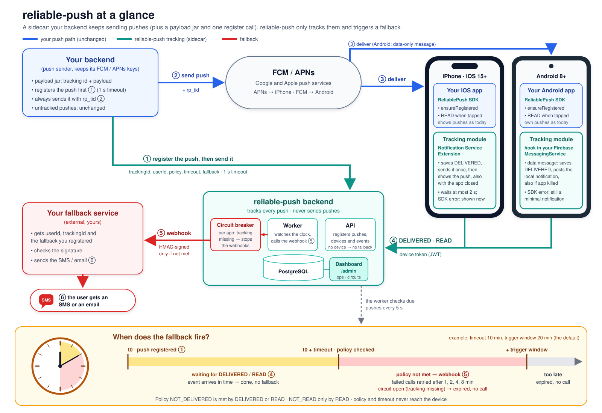
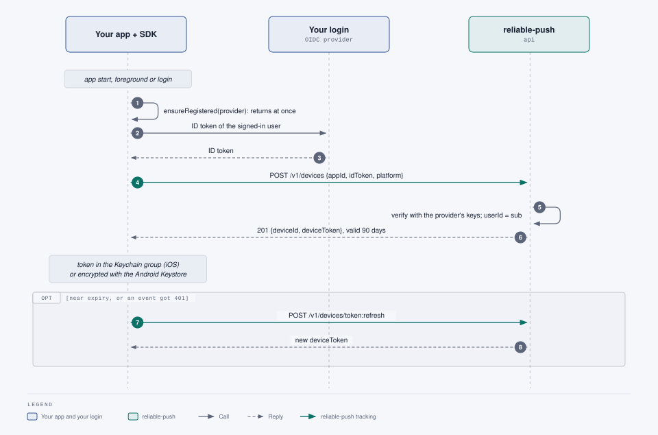
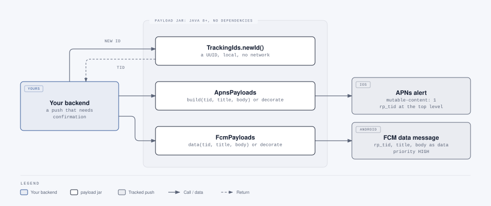
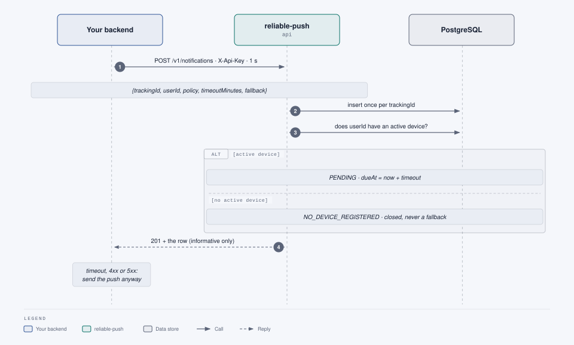
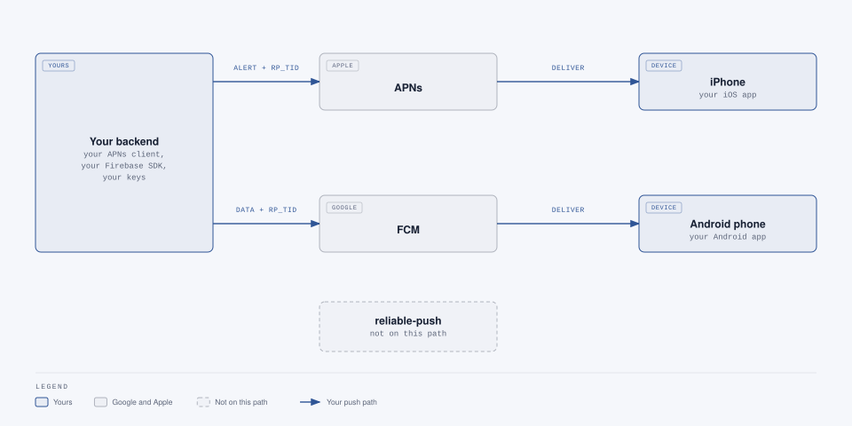
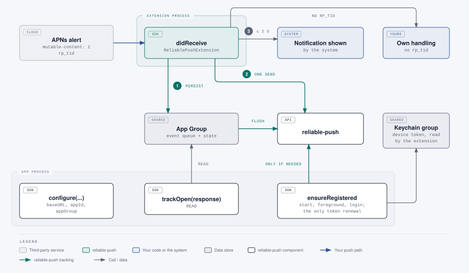
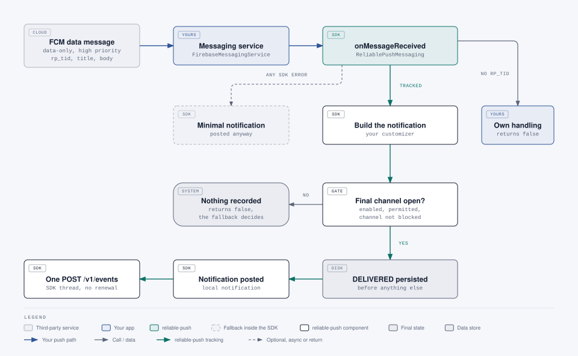
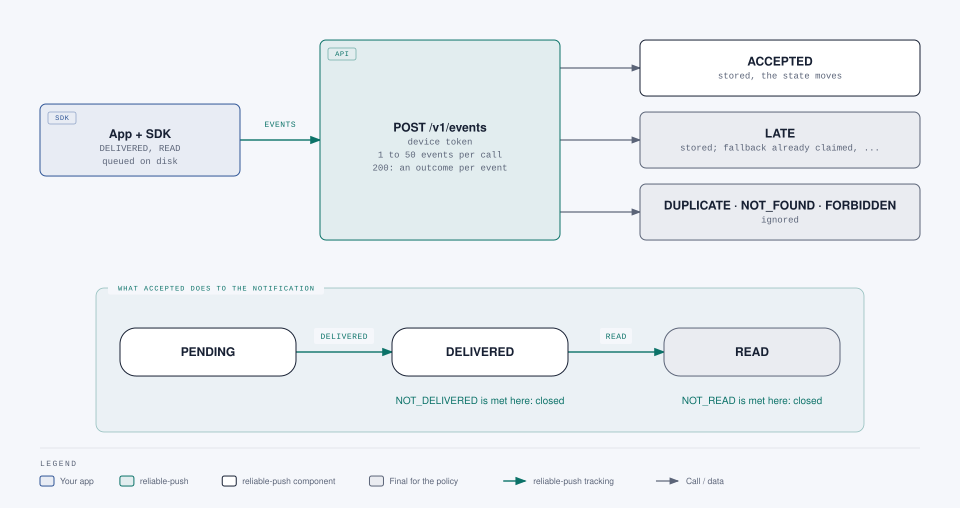
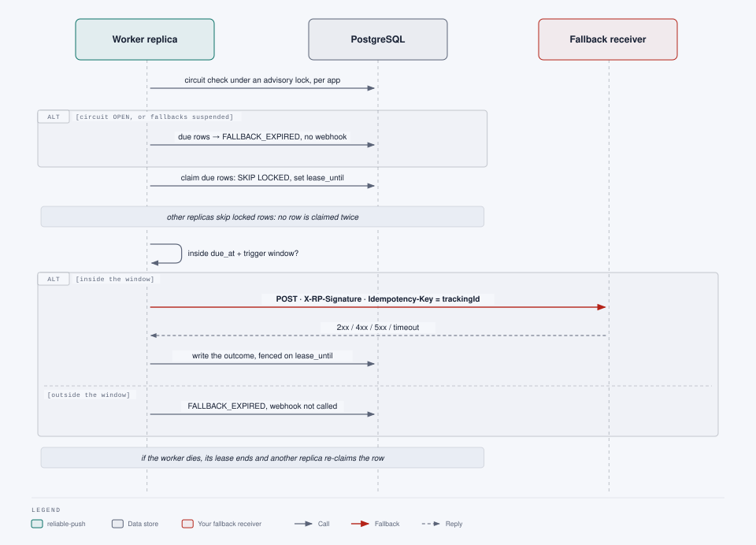
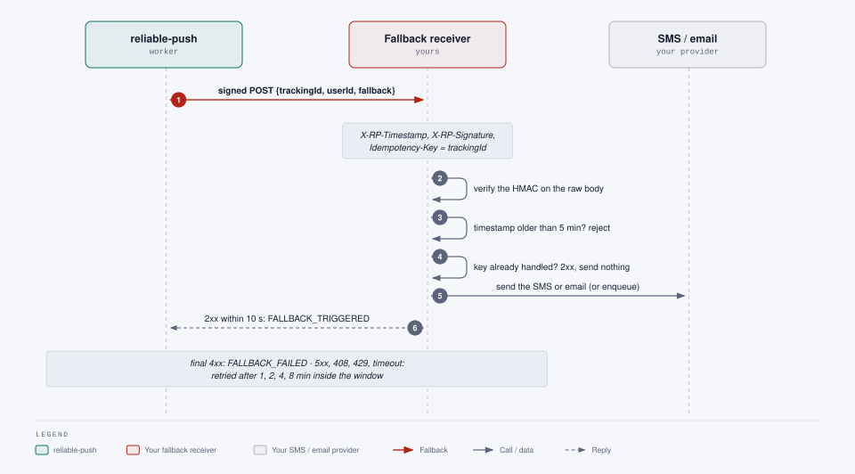

# Flow in detail

This page follows one tracked push from start to end, one step at a time. It starts from the picture below and zooms
into each step with its own diagram. Read it once top to bottom before integrating; the reference documents linked from
each step have the full contracts ([api.md](api.md), [integration-guide.md](integration-guide.md),
[android.md](android.md), [ios.md](ios.md)).



| Step | What happens | Who does it | In the picture |
|---|---|---|---|
| [A](#a-the-device-registers) | The app registers the device, once and then only to renew it | your app, through the SDK | before ① |
| [B1](#b1-choose-the-push-and-create-its-tracking-id) | Your backend decides to track a push and creates its tracking id | your backend, with the payload jar | ① |
| [B2](#b2-build-the-tracked-payload) | The payload jar turns the push into a tracked one | your backend, with the payload jar | ① |
| [B3](#b3-register-the-push-with-reliable-push) | Your backend registers the push, with a 1 s timeout | your backend → reliable-push | ① |
| [B4](#b4-send-the-push-as-today) | Your backend sends the push, always | your backend → FCM / APNs | ② ③ |
| [B5](#b5-the-phone-receives-it) | The phone receives it; the SDK records `DELIVERED` | iOS extension / Android SDK | ③ |
| [B6](#b6-delivered-and-read-reach-reliable-push) | `DELIVERED`, then `READ` on tap, reach reliable-push | SDK → reliable-push | ④ |
| [B7](#b7-reliable-push-waits-then-decides) | At `dueAt`, if the policy is unmet, the worker calls your webhook | reliable-push worker | ⑤ |
| [B8](#b8-your-receiver-sends-the-sms-or-email) | Your receiver sends the SMS or email | your fallback receiver | ⑥ |

## A. The device registers

**Before any tracked push can be confirmed, the app must have registered the device.** reliable-push tracks a push only
when its user has an active device (step B3), and the SDK needs a device token to report events.



1. The app calls `ensureRegistered(provider)` at every start, when it comes to the foreground and after login. The call
   returns at once and does the work in the background.
2. When the app has no token, or it has expired, the SDK asks your `provider` for the signed-in user's ID token (your
   OIDC login, or a signed grant) and calls `POST /v1/devices` with the `appId`, the ID token and the platform.
3. reliable-push verifies the token with the identity provider's keys and takes the user id from it (the `sub` or a
   configured claim), never from the request. It answers with a `deviceId` and a device token valid 90 days.
4. The SDK keeps the token in the Keychain group shared with the extension (iOS) or encrypted with the Android Keystore.
5. Near expiry, or after an event was refused with `401`, the next `ensureRegistered` refreshes the token. This is the
   only place the token is renewed: never while a push is being received.

**What you do:** call `ensureRegistered` with a provider that returns the current ID token, and make the user id in the
token the same id your backend uses as `userId` in step B3. Details: [android.md](android.md), [ios.md](ios.md),
[api.md](api.md#post-v1devices--register-a-device).

**Next:** the device is active, so a push for this user can be tracked.

## B1. Choose the push and create its tracking id

Not every push needs tracking. Track the ones whose loss matters, the ones you would want to resend by SMS or email if
they never reached the phone; everything else stays exactly as today.

For a push you track, your backend creates the tracking id itself, locally, with no network call:

```java
String tid = TrackingIds.newId();   // a UUID; the payload jar, Java 8+, no dependencies
```

The same id goes into the push (B2) and into the registration (B3), and comes back in the events (B6) and in the
fallback webhook (B8). It is how every part recognises the same push.

**Next:** build the push with that id.

## B2. Build the tracked payload



The payload jar turns your title and body (or the payload you already build) into a push the SDK can track:

- **iOS:** an APNs alert with `mutable-content: 1`, so that iOS starts the Notification Service Extension, and `rp_tid`
  at the top level:

  ```json
  {"aps":{"alert":{"title":"Order shipped","body":"Your order 1001 is on its way."},"mutable-content":1},
   "rp_tid":"6f1c2b9e-5d1a-4c55-9a38-0c1f3a7d9e11"}
  ```

- **Android:** an FCM **data-only**, high-priority message with `rp_tid`, `title` and `body` as data, and no
  `notification` block. On Android the SDK draws the notification itself (step B5), which is why the message carries
  the text as data:

  ```json
  {"message":{"token":"<device FCM token>",
   "data":{"rp_tid":"6f1c2b9e-5d1a-4c55-9a38-0c1f3a7d9e11","title":"Order shipped","body":"Your order 1001 is on its way."},
   "android":{"priority":"HIGH"}}}
  ```

The policy and the timeout are **not** in the push: they stay on your side and in reliable-push. When a push cannot be
tracked (for example an iOS push with no visible alert), the jar throws a `PayloadException`: send that push untracked.
Details: [integration-guide.md](integration-guide.md#2-build-the-push-with-the-payload-jar).

**Next:** register the push before sending it.

## B3. Register the push with reliable-push



Your backend calls `POST /v1/notifications` with its API key and a **1 s timeout**:

```json
{"trackingId":"6f1c2b9e-5d1a-4c55-9a38-0c1f3a7d9e11","userId":"user-42",
 "policy":"NOT_READ","timeoutMinutes":10,"fallback":{"sms":"Your order 1001 has shipped."}}
```

- `policy` says what confirms the push: `NOT_DELIVERED` is met by `DELIVERED` or `READ`, `NOT_READ` only by `READ`.
- `timeoutMinutes` sets `dueAt`, the moment the worker checks the policy.
- `fallback` is any JSON you want back in the webhook (the SMS text, a template id); it is never sent to the phone.

reliable-push stores the push once per `trackingId` (a retry with the same id finds the same row). If the user has an
active device, the push is `PENDING` until `dueAt`; if not, it is closed at once as `NO_DEVICE_REGISTERED` and will
never fall back.

**Why before sending:** the phone can confirm a push in less than a second. Registered after the send, the `DELIVERED`
event could arrive first and find nothing to attach to.

**The answer is informative only.** Timeout, `4xx` or `5xx`: send the push anyway (B4). A missed registration means only
that this one push is not tracked; your users never lose a push because of reliable-push. Details:
[integration-guide.md](integration-guide.md#1-register-the-notification).

**Next:** send the push.

## B4. Send the push, as today



Your backend sends the push itself, with its own APNs and FCM credentials, clients and retry logic, exactly as for any
other push, whatever step B3 answered. reliable-push never sends a push and never sees your credentials: it is not on
this path, and if it is down your pushes still go out.

**Next:** the push reaches the phone.

## B5. The phone receives it

The two platforms work differently, but both end with `DELIVERED` written on the phone's disk before anything is sent.

### iPhone: the system shows the alert, the extension confirms it



1. Because of `mutable-content: 1`, iOS starts your **Notification Service Extension** before showing the alert, also
   when the app is closed. A push without `rp_tid` goes to your own extension code, untouched.
2. The SDK saves `DELIVERED` in the App Group queue, sends it once with the token from the shared Keychain (no renewal
   here), and hands the alert back to iOS exactly once: after the send, at 2 s at the latest, at once on an error.
3. iOS shows the notification from the push content. The SDK never builds it, so a tracking problem never hides it.
4. When the user taps it, the app calls `trackOpen(response)`: `READ` is queued and sent.

Details: [ios.md](ios.md).

### Android: the SDK turns the data message into the notification



1. A data message always reaches your `FirebaseMessagingService`, also when the app is in the background or was killed.
   (A `notification` message would be drawn by Android without running any app code, and nobody could confirm it.)
2. Your service hands it to `ReliablePushMessaging.onMessageReceived`. Without `rp_tid` it returns `false` and your own
   handling continues.
3. The SDK **builds the notification** from the data (title, body, channel, tap intent; your `customizer` adds icon,
   colour, actions) and checks it will really be shown: notifications on, permission granted, channel open. If not,
   nothing is recorded and the fallback will decide.
4. It saves `DELIVERED` on disk, **posts the local notification**, and sends the event once on its own thread.
5. Any SDK error still posts a minimal notification: the user always gets the push.
6. When the user taps it, the app calls `trackOpen(intent)`: `READ` is queued and sent.

Details: [android.md](android.md).

**Next:** the events reach reliable-push.

## B6. DELIVERED and READ reach reliable-push



The SDK sends its queued events to `POST /v1/events` with the device token, one to fifty per call, and retries what
could not be sent (offline, `5xx`, `429`), keeping the queue on disk meanwhile. Each event gets its own outcome:

- `ACCEPTED`: stored, and the notification moves on. A `DELIVERED` meets the `NOT_DELIVERED` policy and a `READ` meets
  both: the notification is closed and will not fall back.
- `LATE`: stored, but too late to change anything (for example the fallback was already claimed).
- `DUPLICATE`, `NOT_FOUND`, `FORBIDDEN`: ignored (seen before, unknown id, or another user's push).

A `READ` counts from any active device of the user. Details: [api.md](api.md#post-v1events--report-delivery-and-read-events).

**Next:** if no confirmation arrives in time, the worker steps in.

## B7. reliable-push waits, then decides



Every 5 s each worker looks for pushes past their `dueAt` whose policy is still unmet:

1. **Circuit check, per app.** If an app's fallbacks come due while almost none of its pushes were confirmed, its
   tracking is broken (an SDK missing from a release, for example): those fallbacks are expired instead of sent, so an
   outage never turns into a storm of needless SMS. The dashboard shows the circuit and lets you resume.
2. **Claim.** The worker locks the due rows with `SKIP LOCKED` and a lease: with many replicas, each push is handled
   once, and a dead worker's rows are taken over.
3. **Still in time?** Within `dueAt` + the trigger window (default 20 min) the webhook is called; later the push is
   `FALLBACK_EXPIRED`, because a late SMS helps nobody.
4. **Signed webhook** to your receiver (B8), then the outcome: `2xx` → `FALLBACK_TRIGGERED`; `5xx`, `408`, `429` or a
   timeout → retried after 1, 2, 4, 8 min inside the window; a final `4xx` → `FALLBACK_FAILED`.

Details: [architecture.md](architecture.md), states: [overview.md](overview.md#notification-states).

**Next:** your receiver reaches the user.

## B8. Your receiver sends the SMS or email



The webhook carries the `trackingId`, the `userId`, your `fallback` object as you registered it, the unmet policy as
`reason`, and the attempt number. Your receiver:

1. verifies `X-RP-Signature` (HMAC-SHA256 over the timestamp and the **raw** body) and rejects a timestamp older than
   5 minutes;
2. treats `Idempotency-Key` (the `trackingId`) as "done once": a repeated call gets `2xx` and sends nothing;
3. sends, or enqueues, the SMS or email with your own provider;
4. answers `2xx` within 10 s. A `4xx` means "never" (no retry); anything else is retried.

Details and a JDK-only verification example: [integration-guide.md](integration-guide.md#3-receive-fallbacks).

## What can go wrong, step by step

| Step | If this happens | Result |
|---|---|---|
| A | The app never calls `ensureRegistered`, or the user has not logged in | No active device: pushes for the user are `NO_DEVICE_REGISTERED`, never fall back |
| B2 | The push cannot be tracked (`PayloadException`) | Send it untracked; nothing else changes |
| B3 | reliable-push times out or answers an error | Send the push anyway; this push is not tracked, or tracked if the row was stored |
| B4 | FCM or APNs reject or lose the push | No `DELIVERED`: at `dueAt` the fallback reaches the user |
| B5 | The phone is off, offline or the notifications are blocked | No `DELIVERED` in time: fallback. Events queued offline are sent later; once the fallback was claimed they are `LATE` |
| B6 | The device token expired long ago (`401`) | Events wait on the phone until the next `ensureRegistered` |
| B7 | Tracking is broken for a whole app | The circuit opens: those fallbacks expire instead of sending an SMS storm |
| B8 | Your receiver is down | Retries for up to the trigger window, then `FALLBACK_EXPIRED` |
