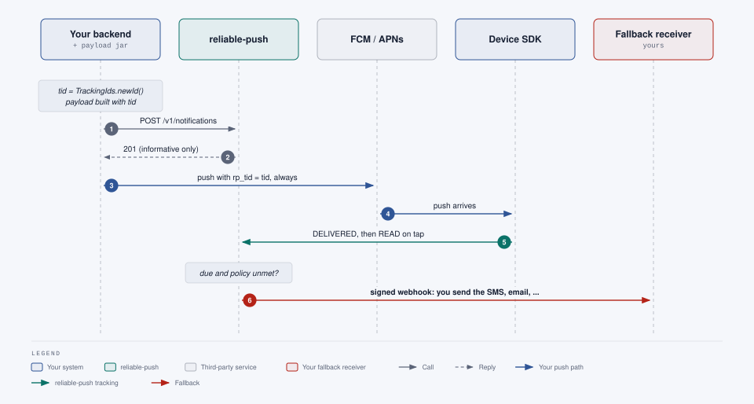

# Integration guide

reliable-push is a sidecar: your existing backend keeps sending pushes through FCM and APNs and keeps those credentials.
You add three things: (1) for each push you want tracked, generate a tracking id, register the notification with
reliable-push and send the push with that id as `rp_tid`; (2) run a **fallback receiver**, an HTTPS endpoint that
reliable-push calls when a push was not delivered or read in time; (3) embed the SDK in your mobile apps
([android.md](android.md), [ios.md](ios.md)), which reports `DELIVERED` and `READ`.

## What your backend must change

- [ ] **Add the payload jar** `io.reliablepush:reliable-push-payload` (Java 8+, zero dependencies,
      [`payload-java/README.md`](../payload-java/README.md)). Other languages implement the same rules and check them
      against the [golden vectors](#other-languages-golden-vectors).
- [ ] **Generate the tracking id yourself:** `TrackingIds.newId()` (a random UUID, lower case). No network call.
- [ ] **Register before sending:** `POST /v1/notifications` with that `trackingId`, a **short timeout (1 s
      recommended)**. The result is informative only.
- [ ] **Always send the push, with `rp_tid`,** whatever the registration answered (success, error or timeout).
- [ ] **Build the payload with the jar** (`ApnsPayloads`, `FcmPayloads`): APNs gets `mutable-content: 1` and a top-level
      `rp_tid`; **Android gets a data-only, high-priority FCM message** (no `notification` block): the SDK posts the
      notification itself ([section 2](#android-data-message-local-notification)).
- [ ] **Catch `PayloadException`** and send that push untracked, as before.
- [ ] **Untracked pushes stay exactly as they are:** no call to reliable-push, no `rp_tid`.



**Your push path does not depend on reliable-push.** Registration is a separate, bounded call and the push goes out
whatever it answers. Tracking and the fallback need a registered notification **and** a user with a registered device
for the app; everything else is sent as today. Failure cases on the device: [overview.md](overview.md#1-the-sidecar-principle).

## Prerequisites (operator side)

Per app, in the backend configuration ([operations.md](operations.md)): a sender API key (only its SHA-256 is configured),
the identity setup that lets devices register (`oidc` or `signed-grant`), and the `fallback` block with your receiver URL
and HMAC secret. Defaults for `policy` and `timeoutMinutes` are per app as well.

## 1. Register the notification

For every push that needs tracking:

```
1. tid     = TrackingIds.newId()                       payload jar, local, no network
2. POST /v1/notifications {trackingId: tid, userId, policy?, timeoutMinutes?, externalId?, fallback}
           timeout 1 s (recommended), result informative only
3. payload = ApnsPayloads / FcmPayloads (build or decorate, with tid)
4. send the push through your own APNs / FCM client, always
```

Build the payload before registering if you want a `PayloadException` to skip the registration.

```sh
curl -sS -X POST "$RP_URL/v1/notifications" --max-time 1 \
  -H "X-Api-Key: $RP_SENDER_KEY" -H 'Content-Type: application/json' \
  -d '{"trackingId":"6f1c2b9e-5d1a-4c55-9a38-0c1f3a7d9e11","userId":"user-42","externalId":"order-1001-shipped",
       "policy":"NOT_DELIVERED","timeoutMinutes":10,
       "fallback":{"channel":"sms","to":"+15550100","text":"Your order 1001 has shipped."}}'
# 201 {"trackingId":"6f1c2b9e-5d1a-4c55-9a38-0c1f3a7d9e11","state":"PENDING","dueAt":"...", ...}
```

- `trackingId` is required: a UUID you generate (`400` naming the field when it is missing or malformed). The backend
  stores and returns it in lower case. Repeating the call with the same `trackingId` returns the same row (idempotent),
  so a retry is safe.
- `userId` is the recipient, the same user id your identity provider puts in the ID token (`sub` unless configured
  otherwise).
- `policy`: `NOT_DELIVERED` (fallback unless the push reached the device) or `NOT_READ` (fallback unless the user opened it).
- `fallback` is an opaque JSON object of at most 4 KB. reliable-push stores it and hands it back to your receiver unchanged;
  it never appears in API responses or logs.
- `externalId` (your own message id) is optional and unique per app: the same `externalId` with another `trackingId`
  is `409`.

What happens for each outcome of the registration:

| Registration result | Push sent? | Tracking | Fallback |
|---|---|---|---|
| `201`, state `PENDING` | yes, with `rp_tid` | yes | if the policy is unmet when due |
| `201`, state `NO_DEVICE_REGISTERED` (the user has no active device for the app) | yes, with `rp_tid` (harmless) | no | never; send your own SMS if you need one |
| `4xx` (validation, auth, `409`) | yes, with `rp_tid` | no (the device reports an unknown id, which is ignored) | never; a sender bug to fix |
| timeout, `5xx` or network error, row **not** stored | yes, with `rp_tid` | no | never (a missed fallback, accepted) |
| timeout, row **stored** (the response was lost) | yes, with `rp_tid` | yes | as for `PENDING`: no duplicate |
| retry with the same `trackingId` | n/a | same row (idempotent) | once |

A user's device is active while it is not revoked and its device token expired less than the app's
`device-token-events-grace` ago (90 days by default). A device registered after the notification does not reopen a
`NO_DEVICE_REGISTERED` row.

**The accepted residual case.** The registration times out on your side, you send the push, it is delivered, and the
registration commits only **after** the device's `DELIVERED` arrived. That event got `NOT_FOUND` and was dropped, so a
fallback fires that was not needed. It takes a registration slower than both your timeout and the whole APNs/FCM
delivery. The histogram `rp_notification_registration_seconds` ([operations.md](operations.md#health-and-metrics))
shows how close an installation comes to it. There is no buffer for early events.

Full reference: [api.md](api.md).

### From Java: the sender client

Java and Kotlin backends can use the zero-dependency client instead of raw HTTP (JDK 17+, `java.net.http`). Install,
error handling and thread-safety notes are in [`client-java/README.md`](../client-java/README.md). For registration
before each send, give it a 1 s timeout (the default stays 10 s for other uses):

```java
SenderClient client = SenderClient.builder()
        .baseUrl(URI.create(System.getenv("RP_URL")))
        .apiKey(System.getenv("RP_SENDER_KEY"))
        .timeout(Duration.ofSeconds(1))                  // bounds the whole call; on expiry status() is -1
        .build();

String tid = TrackingIds.newId();                        // reliable-push-payload
try {
    client.register(RegisterRequest.builder()
            .trackingId(tid)                             // required
            .userId("user-42")
            .externalId("order-1001-shipped")
            .policy(FallbackPolicy.NOT_DELIVERED)
            .timeoutMinutes(10)
            .fallback(Map.of("channel", "sms", "to", "+15550100", "text", "Your order 1001 has shipped."))
            .build());
} catch (ReliablePushException e) {
    log.warn("reliable-push registration failed: status {}", e.status());   // informative only
}
// then build the payload with tid and send the push, whatever happened above
```

`register`, `get`, `list` and `cancel` map to the sender endpoints. A state the client does not know is
`NotificationState.UNKNOWN`; `NO_DEVICE_REGISTERED` is known.

## 2. Build the push with the payload jar

The tracking id travels as the string `rp_tid` (a UUID). The policy and timeout are **not** sent to the device. The jar
builds a tracked payload from title and body (`build`), or adds what tracking needs to the payload you already have
(`decorate`). It checks the rules and fails fast with a `PayloadException`; nothing is dropped silently.

```xml
<dependency>
  <groupId>io.reliablepush</groupId>
  <artifactId>reliable-push-payload</artifactId>
  <version>0.2.0</version>   <!-- not on Maven Central yet: ./mvnw -B -pl payload-java install -->
</dependency>
```

### iOS: raw APNs over HTTP/2

```java
String body = ApnsPayloads.build(tid, "Order shipped", "Your order 1001 is on its way.", Map.of("orderId", 1001));
// or: String body = ApnsPayloads.decorate(myApnsJson, tid);   // needs a visible aps.alert

HttpRequest request = HttpRequest.newBuilder(URI.create("https://api.push.apple.com/3/device/" + deviceToken))
        .header("authorization", "bearer " + providerJwt)          // your APNs auth, unchanged
        .header("apns-topic", "com.example.app")
        .header("apns-push-type", "alert")
        .POST(HttpRequest.BodyPublishers.ofString(body, StandardCharsets.UTF_8))
        .build();
http.send(request, HttpResponse.BodyHandlers.ofString());          // HttpClient with Version.HTTP_2
```

The result is the payload the Notification Service Extension needs:

```json
{"aps":{"alert":{"title":"Order shipped","body":"Your order 1001 is on its way."},"mutable-content":1},
 "rp_tid":"6f1c2b9e-5d1a-4c55-9a38-0c1f3a7d9e11","orderId":1001}
```

`mutable-content: 1` makes iOS start the extension; `rp_tid` sits at the top level, next to `aps`. A push without a
visible alert (`content-available` only) or with a localized alert only (`loc-key`) cannot be tracked: the jar rejects
it with `APNS_NO_ALERT`, send it untracked.

### iOS: Pushy

```java
String payload = ApnsPayloads.build(tid, "Order shipped", "Your order 1001 is on its way.", null);
SimpleApnsPushNotification notification =
        new SimpleApnsPushNotification(TokenUtil.sanitizeTokenString(deviceToken), "com.example.app", payload);
apnsClient.sendNotification(notification);                         // your ApnsClient, unchanged
```

### Android: Firebase Admin SDK

```java
Message message = Message.builder()
        .setToken(fcmToken)
        .putAllData(FcmPayloads.data(tid, "Order shipped", "Your order 1001 is on its way.", Map.of("orderId", "1001")))
        .setAndroidConfig(AndroidConfig.builder().setPriority(AndroidConfig.Priority.HIGH).build())
        .build();                                                  // no setNotification(...)
FirebaseMessaging.getInstance().send(message);
```

With the FCM HTTP v1 API directly, `FcmPayloads.build(fcmToken, tid, title, body, data)` returns the whole request body,
and `FcmPayloads.decorate(myFcmV1Json, tid)` converts your existing message (`notification` title and body move into
`data`, `android.priority` becomes `HIGH`):

```json
{"message":{"token":"<device FCM token>",
 "data":{"rp_tid":"6f1c2b9e-5d1a-4c55-9a38-0c1f3a7d9e11","title":"Order shipped","body":"Your order 1001 is on its way."},
 "android":{"priority":"HIGH"}}}
```

Data values are strings only. A `notification` field other than title and body (image, channel, click action) is
rejected with `FCM_UNSUPPORTED_NOTIFICATION_FIELD`, because the SDK would not show it. A message with no visible title
or body (a silent data-only message) is rejected with `FCM_NO_NOTIFICATION`: the SDK shows every tracked message, so
it would become a blank notification; send it untracked. The jar embeds `rp_tid` lower-cased whatever the case of the
id you pass.

### Android: data message, local notification

Tracked Android pushes are **data-only** messages, and the SDK posts the notification on the device. The reason: for a
message with a `notification` block, Android shows the notification itself while the app is in the background and runs
no app code, so nothing could report `DELIVERED`. A high-priority data message always reaches the app's
`FirebaseMessagingService`, also in the background or after the app was killed, and the SDK turns it into a local
notification. This is the market-standard model for confirmed delivery on Android: Catapush, OneSignal, Braze and
Airship work the same way.

So the notification depends on the app's code. The SDK is hardened for that: it never lets tracking prevent the
display, and if anything inside it fails it still posts the simplest notification it can (details:
[android.md](android.md#4-hand-fcm-messages-to-the-sdk)). The SDK does not hide tracked notifications, but in this model
it is the one that shows them.

`AndroidConfigV2`, the Android counterpart of the iOS extension (FCM shows the notification and lets the app run code
for it), is a preview SDK outside the public Maven repositories with no announced GA date ([TODO.md](TODO.md) 2.1).
When it ships, the switch happens in the payload jar, so senders that use the jar change nothing.

### iOS through FCM

If you reach iPhones through FCM, the APNs part of the message needs the same two fields:
`ApnsConfig.builder().setAps(Aps.builder().setAlert(alert).setMutableContent(true).build()).putCustomData("rp_tid", tid)`.
The jar does not build this variant; the rules are the ones above.

### Errors: send untracked

```java
String payload;
try {
    payload = ApnsPayloads.decorate(myApnsJson, tid);
} catch (PayloadException e) {
    log.warn("sending untracked: {}", e.code());
    payload = myApnsJson;                                 // and skip the registration, or DELETE it if already done
}
```

If the registration was already made, cancel it (`DELETE /v1/notifications/{trackingId}`): a tracked push that is
never sent must not become a fallback. The error codes are listed in
[`payload-java/README.md`](../payload-java/README.md#errors-catch-payloadexception-send-untracked).

### Other languages: golden vectors

The rules are defined by language-neutral test files:
[`payload-java/src/test/resources/vectors/`](../payload-java/src/test/resources/vectors/) (format in its
[README](../payload-java/src/test/resources/vectors/README.md)). Each file holds an operation, its input and the exact
expected output or error code. The jar's tests run them all; a Node, .NET or PHP backend can implement the same rules
and check itself against the same files. Without the jar, the contract is: a UUID tracking id, embedded lower-cased;
APNs with a visible `aps.alert`, `mutable-content: 1` and a top-level `rp_tid`, at most 4,096 bytes; FCM data-only
with `rp_tid`, `title` and `body` as strings (at least one of `title` and `body` non-empty), `android.priority`
`HIGH`, data at most 4,096 bytes.

## 3. Receive fallbacks

When the policy is unmet at `dueAt`, the worker sends a signed `POST` to the `fallback.url` configured for your app.

Headers:

| Header | Value |
|---|---|
| `Content-Type` | `application/json` |
| `X-RP-Timestamp` | Unix time in seconds when the attempt was signed |
| `X-RP-Signature` | `v1=` + lowercase hex of `HMAC-SHA256(secret, timestamp + "." + body)` |
| `Idempotency-Key` | The `trackingId` |
| `User-Agent` | `reliable-push/<version>` |

Body:

```json
{
  "trackingId": "6f1c2b9e-5d1a-4c55-9a38-0c1f3a7d9e11",
  "userId": "user-42",
  "fallback": { "channel": "sms", "to": "+15550100", "text": "Your order 1001 has shipped." },
  "reason": "NOT_DELIVERED",
  "attempt": 1
}
```

`fallback` is exactly the object you registered, `reason` is the unmet policy, `attempt` counts from 1.

### What the receiver must do

1. **Verify the signature** over the raw body bytes (not a re-serialized JSON), with the shared secret and a constant-time
   comparison. Reject a request whose `X-RP-Timestamp` is stale: more than 5 minutes from your clock is a sensible bound
   (attempts are signed when they are sent; retries get a fresh timestamp).
2. **De-duplicate on `Idempotency-Key`.** A call can arrive more than once: after a retry whose response was lost, or when
   a worker crashed between a successful call and recording it (this extra re-send is not counted against `max-attempts`).
   The `Idempotency-Key` (the `trackingId`) is the **same on every attempt** of one notification, so record it as handled only
   after the work is done or durably enqueued (for example insert it with a unique constraint in the same transaction that
   enqueues the SMS). If you record it first and then fail with a `5xx`, the retry is acknowledged as a duplicate and the SMS
   is never sent. Answer a key that is already recorded with `2xx` without sending again.
3. **Return a `2xx` quickly** (the default budget is 10 s for the whole exchange, `fallback.http-timeout`). Do slow work, such
   as calling an SMS provider, after acknowledging, or from a queue.

How reliable-push reads your response:

| Response | Result |
|---|---|
| `2xx` | Success: the notification becomes `FALLBACK_TRIGGERED` |
| `4xx` except `408` and `429` | Final failure: `FALLBACK_FAILED`, no retry. Use this for "I will never accept this" |
| `408`, `429`, `5xx`, redirects (`3xx`), timeout, connection error | Retried with backoff (default 1, 2, 4, 8 min, at most 5 attempts), as long as the retry still falls inside the trigger window; otherwise `FALLBACK_EXPIRED` |

Redirects are never followed. A fallback is only sent while `now <= dueAt + trigger window` (default 20 min), so a very late
call means the original moment has passed and the notification is closed as `FALLBACK_EXPIRED` without calling you.

**During an open fallback circuit** (FR-18) you get no call either: when your app's notifications come due while almost
none of them are reported `DELIVERED` (tracking is missing, for example the reliable-push API was unreachable for the
devices), the backend closes their fallbacks as `FALLBACK_EXPIRED` without calling the receiver, and never re-sends them.
Calls resume by themselves once deliveries are reported again, or when an operator resumes them. A sender that must
reach those users anyway can list its `FALLBACK_EXPIRED` notifications of that period and re-notify them. Operators:
[operations.md](operations.md#fallback-circuit-breaker).

### Java verification example (JDK only)

```java
import java.nio.charset.StandardCharsets;
import java.security.GeneralSecurityException;
import java.security.MessageDigest;
import java.time.Duration;
import java.time.Instant;
import java.util.HexFormat;
import javax.crypto.Mac;
import javax.crypto.spec.SecretKeySpec;

/** Verifies the X-RP-Signature of a reliable-push fallback webhook. JDK only. */
public final class WebhookVerifier {

    private static final Duration MAX_AGE = Duration.ofMinutes(5);

    private final byte[] secret;

    public WebhookVerifier(String hmacSecret) {
        this.secret = hmacSecret.getBytes(StandardCharsets.UTF_8);
    }

    /**
     * @param timestampHeader value of X-RP-Timestamp (epoch seconds)
     * @param signatureHeader value of X-RP-Signature ("v1=" + hex)
     * @param rawBody         the request body bytes exactly as received (before any JSON parsing)
     */
    public boolean isValid(String timestampHeader, String signatureHeader, byte[] rawBody, Instant now) {
        if (timestampHeader == null || signatureHeader == null || !signatureHeader.startsWith("v1=")) {
            return false;
        }
        long timestamp;
        try {
            timestamp = Long.parseLong(timestampHeader);
        } catch (NumberFormatException e) {
            return false;
        }
        // reject stale (replayed) and far-future timestamps
        Duration age = Duration.between(Instant.ofEpochSecond(timestamp), now).abs();
        if (age.compareTo(MAX_AGE) > 0) {
            return false;
        }
        try {
            Mac mac = Mac.getInstance("HmacSHA256");
            mac.init(new SecretKeySpec(secret, "HmacSHA256"));
            mac.update((timestampHeader + ".").getBytes(StandardCharsets.US_ASCII));
            String expected = "v1=" + HexFormat.of().formatHex(mac.doFinal(rawBody));
            // constant-time comparison
            return MessageDigest.isEqual(
                    expected.getBytes(StandardCharsets.US_ASCII), signatureHeader.getBytes(StandardCharsets.US_ASCII));
        } catch (GeneralSecurityException e) {
            throw new IllegalStateException(e);
        }
    }
}
```

Use it before parsing the body, with the bytes as received:

```java
byte[] body = request.getInputStream().readAllBytes();
boolean ok = verifier.isValid(request.getHeader("X-RP-Timestamp"), request.getHeader("X-RP-Signature"), body, Instant.now());
if (!ok) { response.setStatus(401); return; }
// then: de-duplicate on request.getHeader("Idempotency-Key"), parse the JSON, enqueue the SMS, answer 200
```

A shell check for debugging (the secret and body are yours):

```sh
printf '%s.%s' "$TS" "$BODY" | openssl dgst -sha256 -hmac "$RP_SHOP_HOOK_SECRET" -hex   # compare with the value after "v1="
```

## 4. Mobile apps

The SDKs are initialised with the backend URL and `appId` and report `DELIVERED` from the push entry point and `READ`
on tap. The app keeps the device registered with **`ensureRegistered`**: call it at app start or foreground and right
after login. It returns at once, decides locally whether a call is needed and is the only place where the SDK renews
the device token; the push receive path never does. A user who has never registered a device (or logged out) has no
active device, so your registrations for that user end as `NO_DEVICE_REGISTERED`.

### Android

The Android SDK is described in [android.md](android.md): setup in `Application.onCreate`, `ensureRegistered`, the host
`FirebaseMessagingService`, what `handle` does in which order and how it stays robust, `trackOpen` in the launch
activity, `POST_NOTIFICATIONS`, backup rules, Play Data Safety entries and known limits.

### iOS

The iOS SDK is described in [ios.md](ios.md): the Swift package, the App Group, `configure` in `didFinishLaunching`,
`ensureRegistered`, the Notification Service Extension step by step (it records `DELIVERED`, sends it once and hands
the notification back within `extensionSendTimeout`, 2 s by default), `trackOpen`, App Store privacy entries and known
limits. For any other client, the device API in [api.md](api.md) is the contract.

## Operating notes

- Keep `fallback.url` on HTTPS in production; the secret is configured as an environment variable reference
  ([operations.md](operations.md)). Rotating the secret means changing it on both sides; accept both during the switch if
  you need zero failed calls.
- To stop a pending fallback (for example the order was cancelled), `DELETE /v1/notifications/{trackingId}`.
- Observe outcomes with `GET /v1/notifications/{trackingId}` or the list endpoint, or by metrics and logs
  ([operations.md](operations.md)): `rp_notifications_registered_total{outcome}` shows how many registrations found no
  active device, `rp_notification_registration_seconds` how fast registration answers compared with your timeout.
