# System overview

This page explains reliable-push with diagrams. It starts from the big picture and then shows each component in detail.
The reference documents linked from each section have the full contracts and settings. The diagrams are written in
[Mermaid](https://mermaid.js.org/), which GitHub renders in place.

For a slide-style version to present the project, open [presentation.html](presentation.html) in a browser.

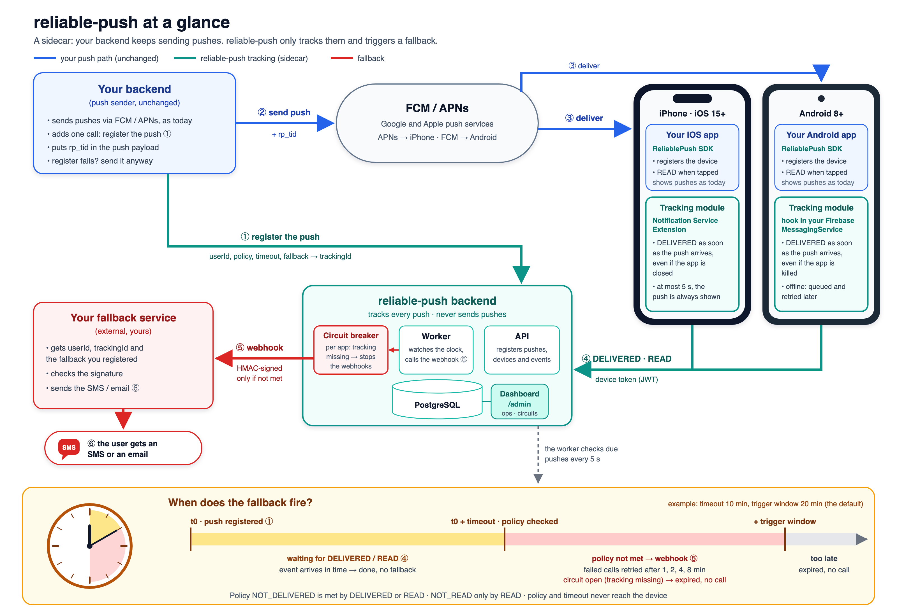

The picture above is the whole system on one page: ① your backend registers the push with reliable-push, ② sends it
through FCM / APNs as today, ③ the phone receives it, ④ the tracking module reports `DELIVERED` and `READ`, ⑤ when the
timeout passes without the policy being met the worker calls your signed webhook, and ⑥ your fallback service sends
the SMS or email. The editable source is [images/reliable-push-at-a-glance.svg](images/reliable-push-at-a-glance.svg).

## 1. The sidecar principle

reliable-push is a **sidecar**. It watches your push notifications and acts only when one is not confirmed in time. It
never sends a push, never holds your FCM or APNs credentials, and is not on the path that delivers a notification.

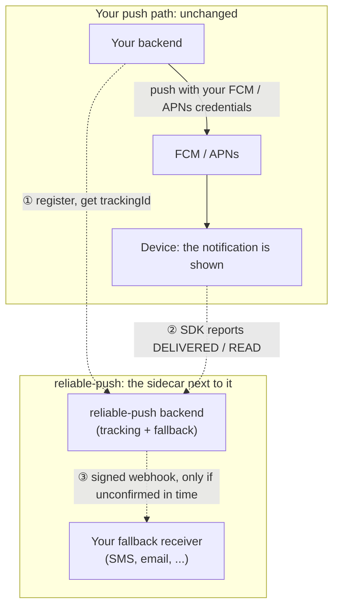

Solid arrows are your existing push path. Dotted arrows are what reliable-push adds.

| If this fails... | ...your pushes | ...and reliable-push |
|---|---|---|
| The reliable-push backend is down or slow | **Still sent and shown.** Your backend decides what to do when registration fails: usually it sends the push anyway, untracked ([integration-guide.md](integration-guide.md#1-register-the-notification)). | Tracking pauses. Device events stay queued on the device and are sent when the backend is back. Due fallbacks are sent late, within the trigger window, or expire. |
| The device is offline when the push arrives | Delivered by FCM / APNs when the device is back, as today. | `DELIVERED` is queued on the device and sent later. If the policy is not met by the timeout, the fallback fires. |
| The SDK cannot reach the backend | **Still shown.** A tracked notification is never hidden. Network work runs in the background and its errors never reach the app. | The event stays in the SDK's on-disk queue and is retried. |
| A push has no `rp_tid` | Untouched: the SDK ignores it and your own code handles it. | Not tracked. |
| The fallback receiver is down | Not affected. | The webhook is retried with backoff inside the trigger window, then the notification ends as `FALLBACK_FAILED` or `FALLBACK_EXPIRED`. |

On iOS the Notification Service Extension hands the notification to the system after the send attempt. It waits at most
`extensionSendTimeout`, 5 s by default. A tracked Android notification is posted at once and the send runs on the SDK's
own thread.

## 2. Components and how they relate

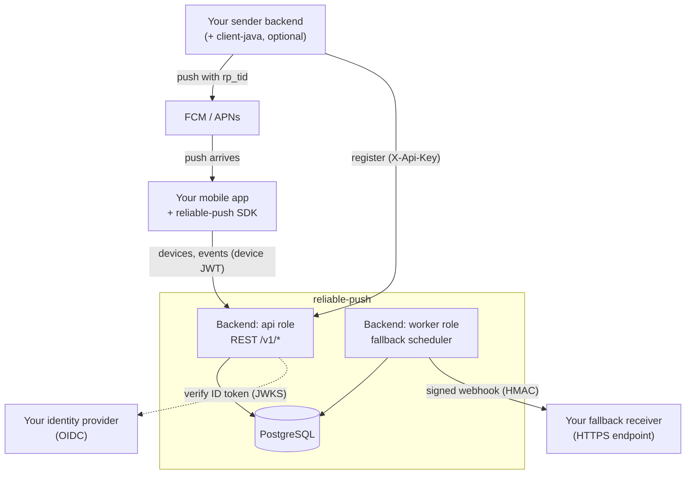

| Component | Path | What it does | Detail |
|---|---|---|---|
| Backend | `backend/` | Stores notifications, receives device events, triggers fallbacks | [§4](#4-backend) |
| Java sender client | `client-java/` | Optional zero-dependency client for the sender API | [§5](#5-java-sender-client) |
| Android SDK | `android/` | Reports `DELIVERED` / `READ` from an Android app | [§6](#6-android-sdk) |
| iOS SDK | `ios/`, `Package.swift` | Reports `DELIVERED` / `READ` from an iOS app and its extension | [§7](#7-ios-sdk) |
| Harness | `harness/` | Local test stack: simulators, fake receiver, web console, E2E | [§8](#8-harness-and-web-console) |
| Helm chart | `deploy/helm/` | Installs the backend on Kubernetes / OpenShift | [§9](#9-helm-chart-and-deployment) |
| Load tests | `loadtest/` | Gatling load tests, run locally | [§10](#10-load-tests) |

## 3. One notification, end to end

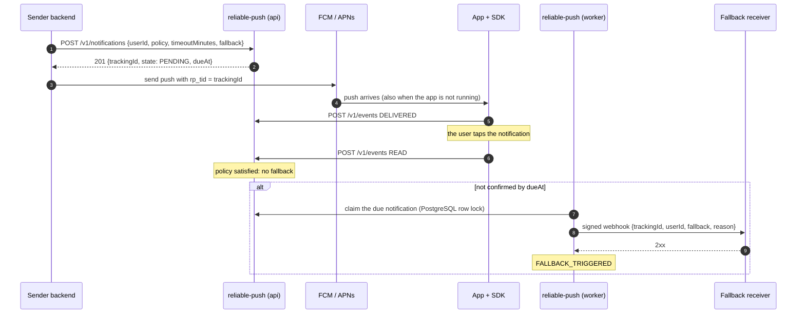

The policy decides what "confirmed" means. With `NOT_DELIVERED`, a `DELIVERED` (or `READ`) satisfies it. With
`NOT_READ`, only `READ` does. The device never sees the policy or the timeout.

### Notification states

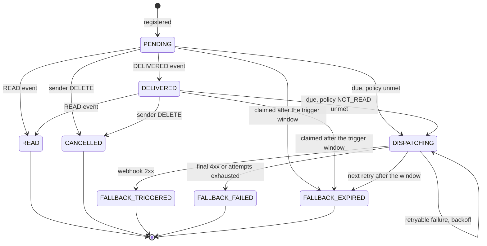

`DISPATCHING` is reported as `FALLBACK_PENDING` by the API. Events that arrive after a fallback was claimed are stored
as `LATE` and change nothing. Full rules: [architecture.md](architecture.md#notification-lifecycle).

## 4. Backend

One Spring Boot application (Java 21) in one container image. PostgreSQL is its only stateful dependency. The same
image runs as `api`, `worker` or both (Spring profiles). Replicas coordinate only through PostgreSQL row locks.

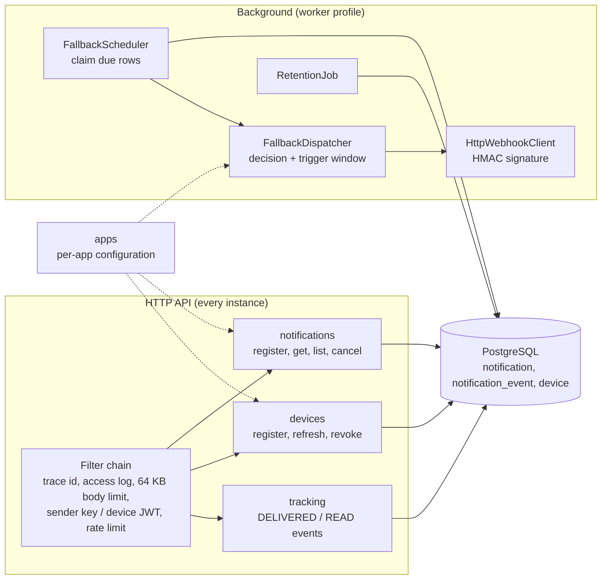

How the worker sends one fallback safely, even with several worker replicas:

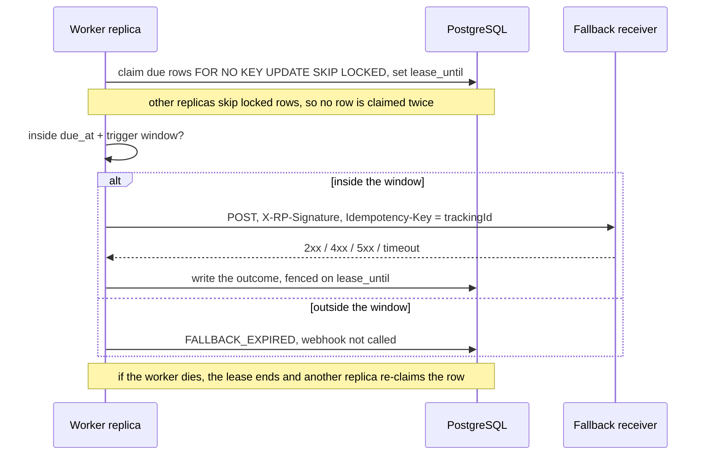

Reference: [architecture.md](architecture.md), [api.md](api.md), [security.md](security.md),
[operations.md](operations.md).

## 5. Java sender client

An optional library for Java senders: JDK 17+ and `java.net.http`, no third-party dependency. Any HTTP client can call
the sender API instead; the contract is [api.md](api.md).

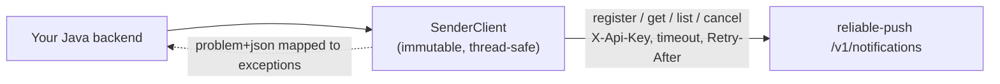

Reference: [client-java/README.md](../client-java/README.md).

## 6. Android SDK

Kotlin library, minSdk 26, Android platform APIs only. It plugs into the app's own `FirebaseMessagingService` and
ignores every message without `rp_tid`.

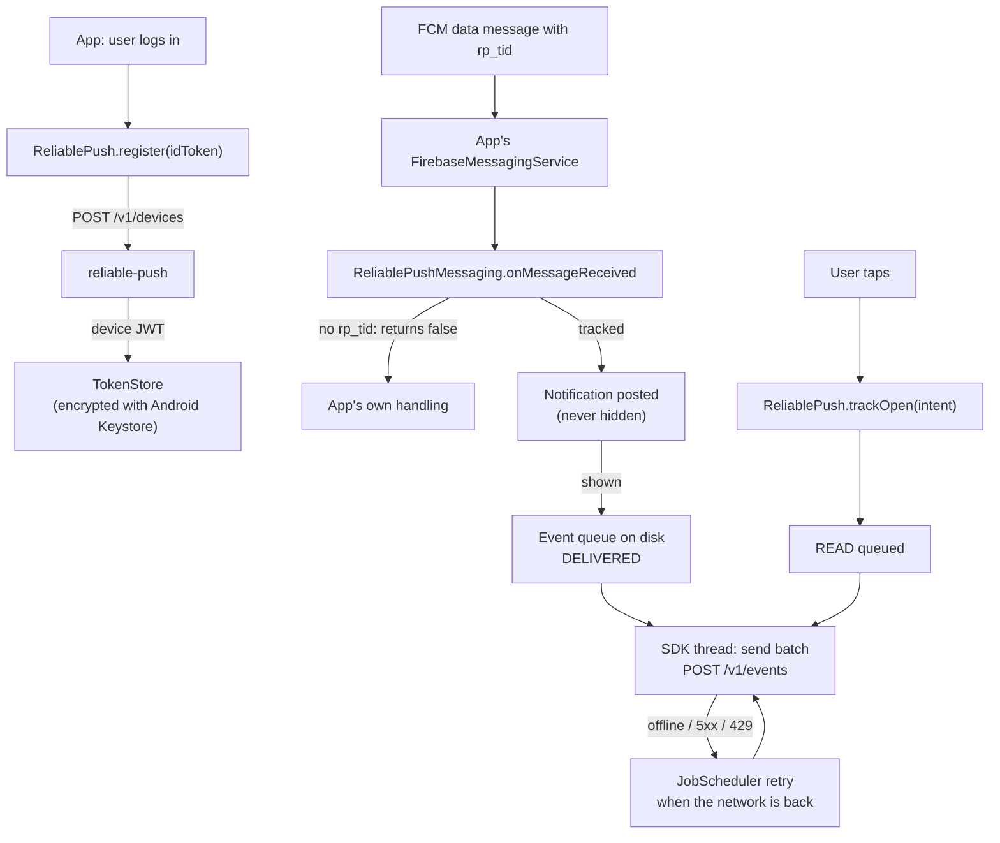

`DELIVERED` is sent only when the notification was really shown. If notifications are blocked, nothing is sent and
the fallback decides. Reference: [android.md](android.md).

## 7. iOS SDK

Swift package, iOS 15+, Apple frameworks only. The app and its Notification Service Extension (NSE) share the device
token through a Keychain access group and the event queue through an App Group.

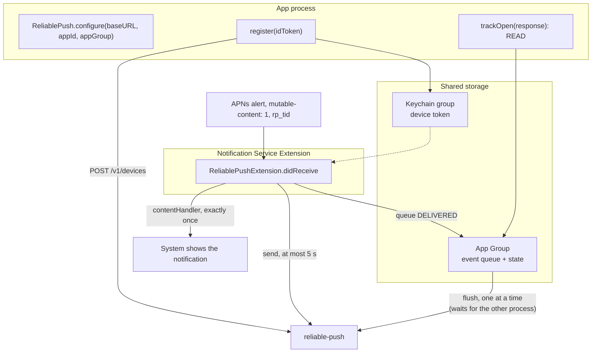

The extension calls the content handler exactly once: after the send, at the send timeout, or when iOS ends the
extension. Reference: [ios.md](ios.md).

## 8. Harness and web console

The harness is a local test stack. It is never built into the backend image and never deployed. It runs the real
backend (one API, two workers) with simulated senders, devices and fallback receivers.

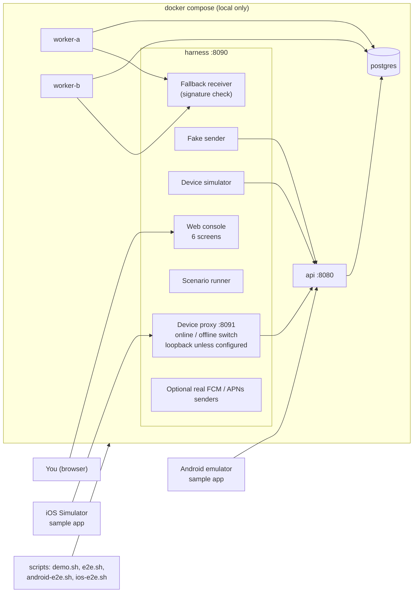

Reference: [testing.md](testing.md), [getting-started.md](getting-started.md).

## 9. Helm chart and deployment

The chart installs the backend only. PostgreSQL is yours (managed or operator). It runs **combined** (every pod is
API and worker) or **split** (API pods behind the Service, worker pods with no traffic).

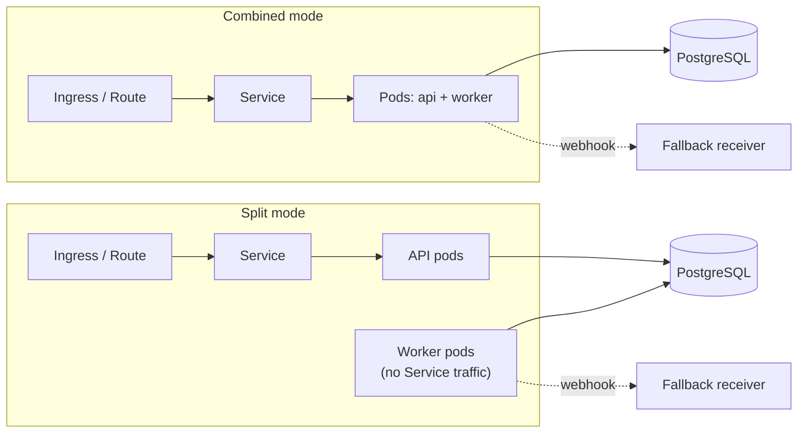

Values for GKE and OpenShift are included (non-root, arbitrary UID). Reference: [deployment.md](deployment.md).

## 10. Load tests

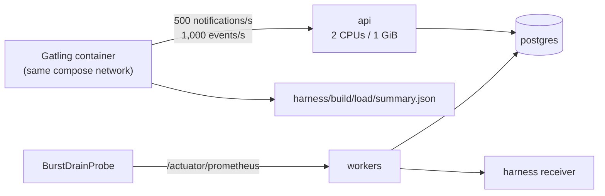

NFR-2 (at least 1,000 events/s per replica) was validated locally. Reference:
[operations.md, "Measured capacity"](operations.md#measured-capacity) and [testing.md](testing.md#load-tests-local-only).
