# System overview

This page explains reliable-push with diagrams. It starts from the big picture and then shows each component in detail.
The reference documents linked from each section have the full contracts and settings. The diagrams are written in
[Mermaid](https://mermaid.js.org/), which GitHub renders in place.

For a slide-style version to present the project, open [presentation.html](presentation.html) in a browser.

The picture above is the whole system on one page: ① your backend generates a tracking id with the payload jar and
registers the push with reliable-push (1 s timeout), ② sends it through FCM / APNs whatever the registration answered, ③ the phone receives it, ④ the tracking module reports `DELIVERED` and `READ`, ⑤ when the
timeout passes without the policy being met the worker calls your signed webhook, and ⑥ your fallback service sends
the SMS or email. Before the worker claims anything, the per-app **circuit breaker** checks that delivery tracking still
works: when an app's fallbacks come due while almost none of its pushes were reported delivered, it stops that app's
fallbacks instead of firing a storm of needless SMS ([§4](#4-backend)). The small "Dashboard /admin" box in the backend is
the ops dashboard ([§5](#5-ops-dashboard)), read-only except the fallback resume. The editable source is [images/reliable-push-at-a-glance.svg](images/reliable-push-at-a-glance.svg).

## 1. The sidecar principle

reliable-push is a **sidecar**. It watches your push notifications and acts only when one is not confirmed in time. It
never sends a push, never holds your FCM or APNs credentials, and is not on the path that delivers a notification.

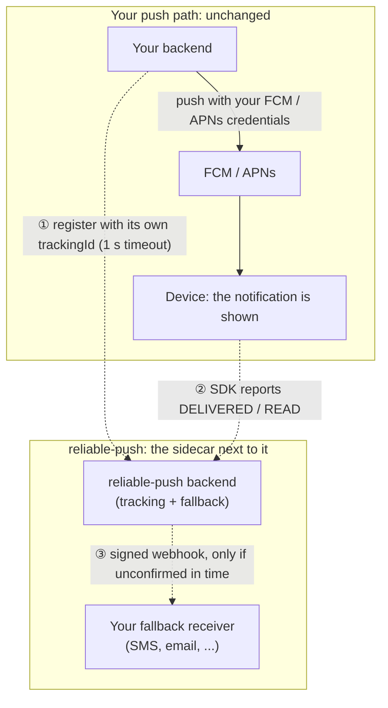

Solid arrows are your existing push path. Dotted arrows are what reliable-push adds.

| If this fails... | ...your pushes | ...and reliable-push |
|---|---|---|
| The reliable-push backend is down or slow | **Still sent and shown.** Your backend registers with a short timeout (1 s) and sends the push with `rp_tid` whatever the answer; a registration that was not stored only means no fallback for that push ([integration-guide.md](integration-guide.md#1-register-the-notification)). | Tracking pauses. Device events stay queued on the device and are sent when the backend is back. Due fallbacks are sent late, within the trigger window, or expire. |
| The device is offline when the push arrives | Delivered by FCM / APNs when the device is back, as today. | `DELIVERED` is queued on the device and sent later. If the policy is not met by the timeout, the fallback fires. |
| The SDK cannot reach the backend | **Still shown.** iOS hands the notification back after at most `extensionSendTimeout` (2 s by default); Android posts it before the send, which runs in the background. Errors never reach the app. | The event stays in the SDK's on-disk queue and is retried. |
| The SDK fails internally | **Still shown.** iOS hands back the best content so far at once; Android posts the simplest notification it can. | Nothing or `DELIVERED` recorded, depending on where it failed; the fallback decides. |
| The user has no registered device | Sent as usual. | Stored as `NO_DEVICE_REGISTERED`: not tracked, never a fallback. |
| A push has no `rp_tid` | Untouched: the SDK ignores it and your own code handles it. | Not tracked. |
| The fallback receiver is down | Not affected. | The webhook is retried with backoff inside the trigger window, then the notification ends as `FALLBACK_FAILED` or `FALLBACK_EXPIRED`. |

On iOS the Notification Service Extension records `DELIVERED`, sends it once and hands the notification to the system
when the send ends, at most `extensionSendTimeout` (2 s by default) later. On Android the backend sends a data-only
message and the SDK posts the notification itself (the market-standard model, [android.md](android.md)); `DELIVERED`
is persisted just before the post and sent on the SDK's own thread. Neither path renews the device token: only the
app's `ensureRegistered` does.

## 2. Components and how they relate

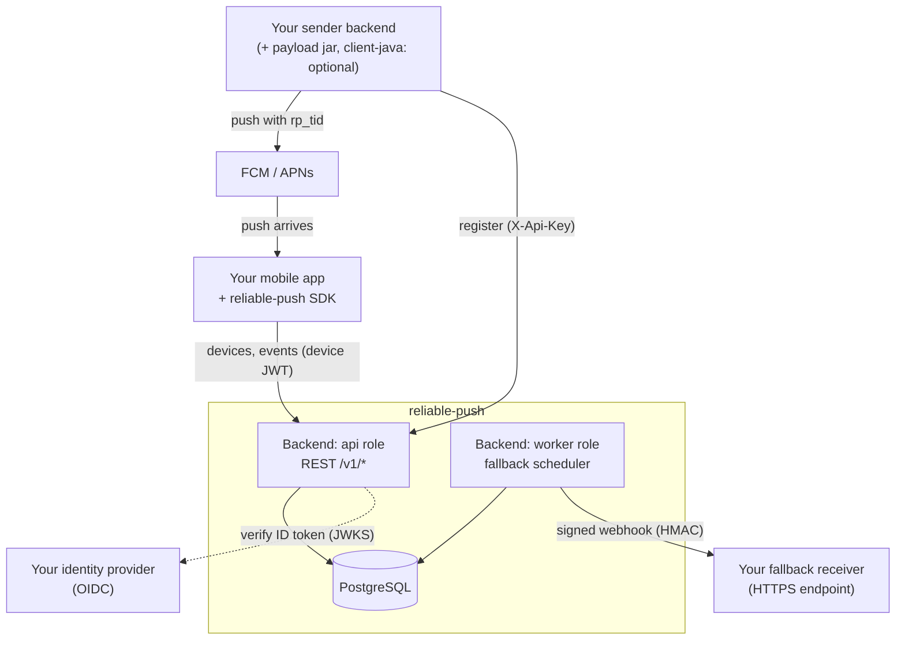

| Component | Path | What it does | Detail |
|---|---|---|---|
| Backend | `backend/` | Stores notifications, receives device events, triggers fallbacks | [§4](#4-backend) |
| Ops dashboard | `backend/` (module `admin`) | Web page and API for support, ops and product, read-only except the fallback resume | [§5](#5-ops-dashboard) |
| Java sender client | `client-java/` | Optional zero-dependency client for the sender API | [§6](#6-java-sender-client-and-payload-jar) |
| Payload jar | `payload-java/` | Optional zero-dependency Java 8+ library: tracking ids, tracked APNs / FCM payloads, golden vectors | [§6](#6-java-sender-client-and-payload-jar) |
| Android SDK | `android/` | Reports `DELIVERED` / `READ` from an Android app | [§7](#7-android-sdk) |
| iOS SDK | `ios/`, `Package.swift` | Reports `DELIVERED` / `READ` from an iOS app and its extension | [§8](#8-ios-sdk) |
| Harness | `harness/` | Local test stack: simulators, fake receiver, web console, E2E | [§9](#9-harness-and-web-console) |
| Helm chart | `deploy/helm/` | Installs the backend on Kubernetes / OpenShift | [§10](#10-helm-chart-and-deployment) |
| Load tests | `loadtest/` | Gatling load tests, run locally | [§11](#11-load-tests) |

## 3. One notification, end to end

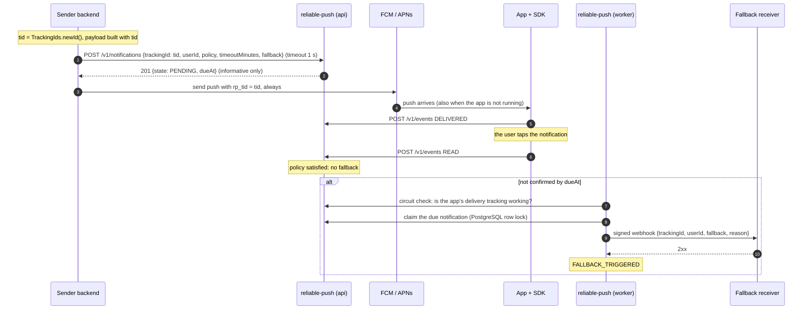

If the user has no active device the answer is `201` with state `NO_DEVICE_REGISTERED` and nothing else happens. If
the registration fails or times out the push is still sent: a row that was stored is tracked as usual (no duplicate
fallback), one that was not means no fallback. The outcome table is in
[integration-guide.md](integration-guide.md#1-register-the-notification).

The policy decides what "confirmed" means. With `NOT_DELIVERED`, a `DELIVERED` (or `READ`) satisfies it. With
`NOT_READ`, only `READ` does. The device never sees the policy or the timeout.

### Notification states

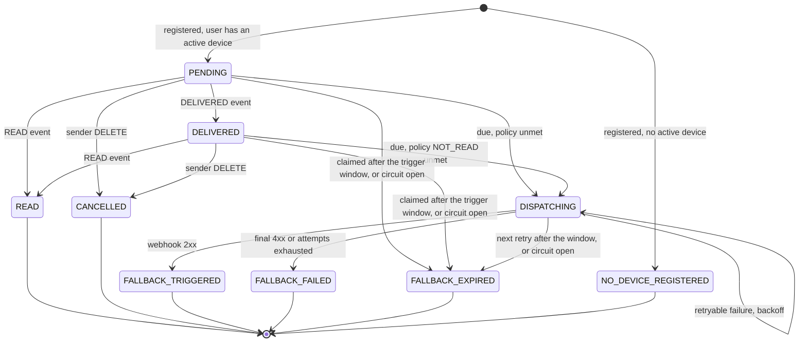

`DISPATCHING` is reported as `FALLBACK_PENDING` by the API. Events that arrive after a fallback was claimed are stored
as `LATE` and change nothing. Full rules: [architecture.md](architecture.md#notification-lifecycle).

## 4. Backend

One Spring Boot application (Java 21) in one container image. PostgreSQL is its only stateful dependency. The same
image runs as `api`, `worker` or both (Spring profiles). Replicas coordinate only through PostgreSQL row locks.

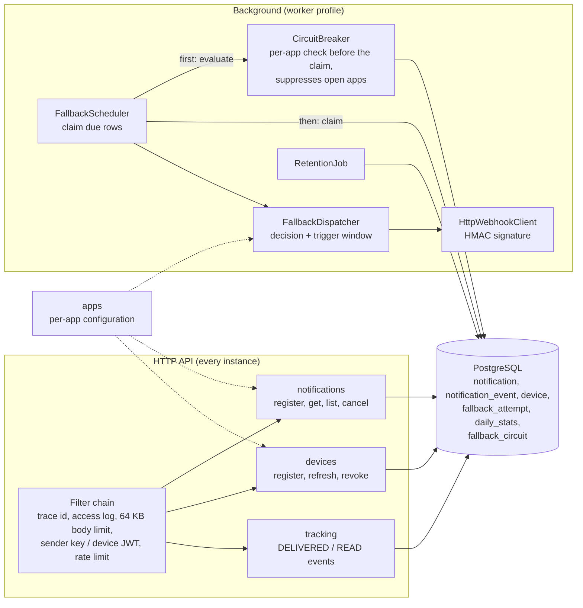

How the worker sends one fallback safely, even with several worker replicas:

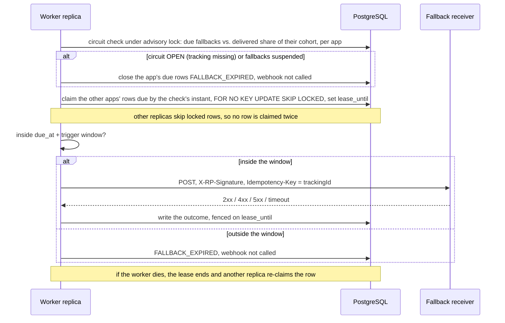

The claim takes only rows that were due when the circuits were checked, so every fallback fired was counted by a check.
The circuit closes by itself once deliveries are reported again; an operator with `fallback-control` can force it from
the dashboard. Fallbacks suppressed while it was open are never re-sent. Opens, closes and failed checks are logged and
counted (`rp_fallback_circuit_transitions_total`, `rp_fallback_circuit_check_failed_total`).

Reference: [architecture.md](architecture.md), [api.md](api.md), [security.md](security.md),
[operations.md](operations.md) (circuit breaker and its runbook).

## 5. Ops dashboard

A page (`/admin/`) and API (`/v1/admin`) served by the backend, read-only except the fallback resume, for support ("what
happened to this push?"), ops (rates, backlog and fallback circuits now) and product (daily trends). It exists only when an admin key is configured; otherwise both paths
answer `404`. Guide: [admin.md](admin.md).

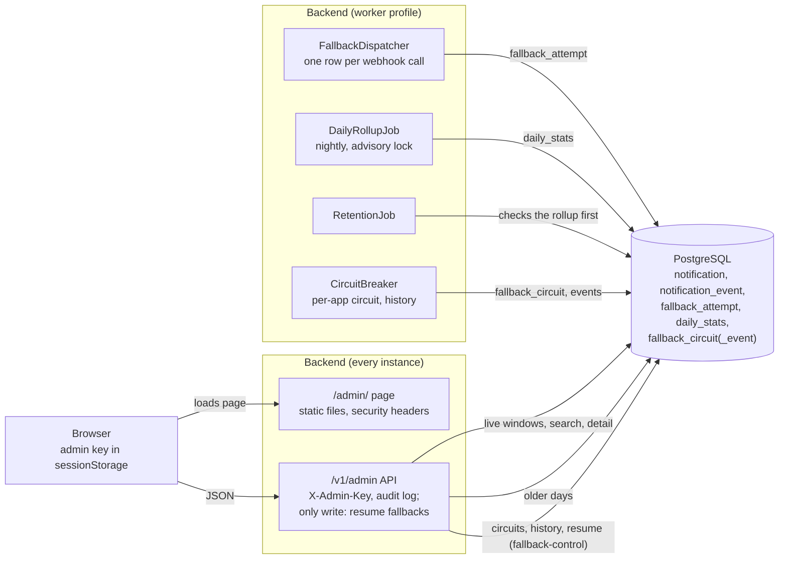

Live windows and the last 7 days are computed from `notification`. Older days come from `daily_stats`, which outlives the
notifications. Retention skips its purge when the rollup did not run, so no day is deleted before it was counted.

## 6. Java sender client and payload jar

Two optional libraries for Java senders, independent of each other. The **payload jar** (Java 8+, no dependency, no
network) generates the tracking id and builds or decorates the APNs and FCM payloads, so the sender does not need to
know the payload rules; golden vectors define the same rules for other languages. The **sender client** (JDK 17+,
`java.net.http`) calls the sender API; any HTTP client can do the same ([api.md](api.md)).

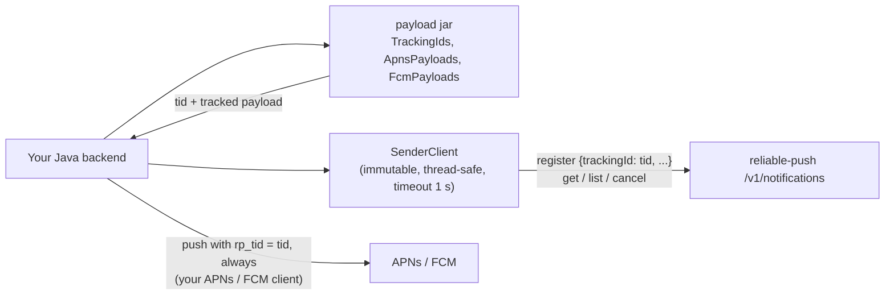

A `PayloadException` means the push cannot be tracked: send it untracked, as before. Reference:
[payload-java/README.md](../payload-java/README.md), [client-java/README.md](../client-java/README.md).

## 7. Android SDK

Kotlin library, minSdk 26, Android platform APIs only. It plugs into the app's own `FirebaseMessagingService` and
ignores every message without `rp_tid`.

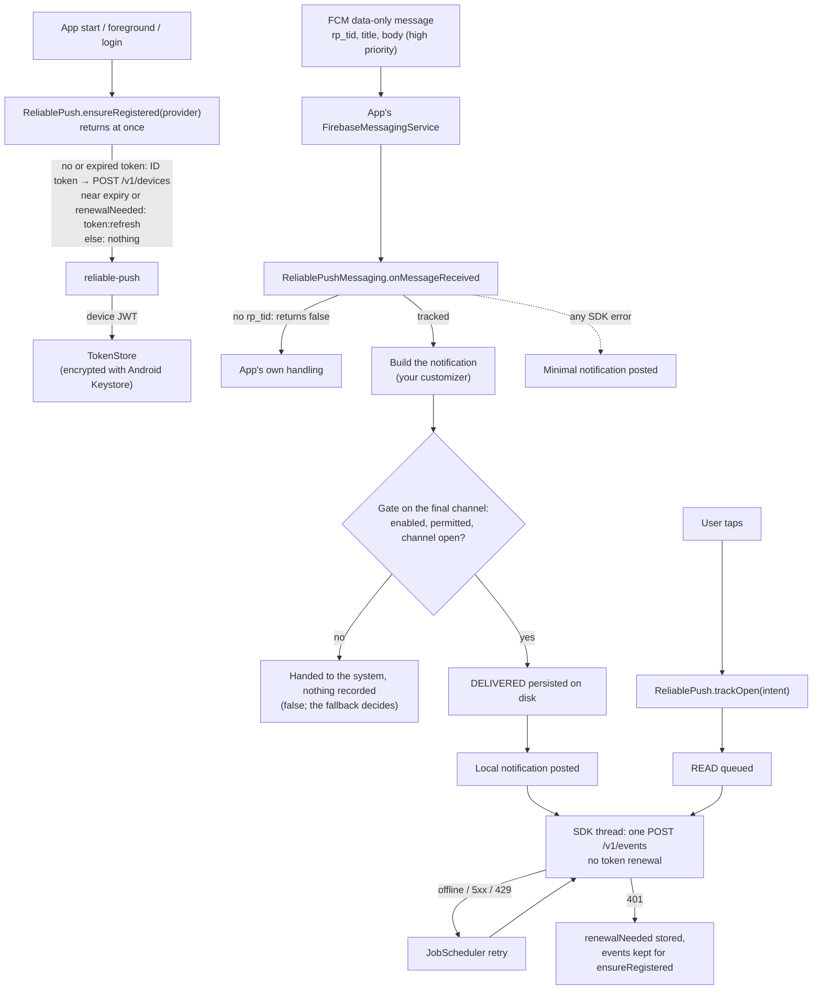

The SDK posts tracked notifications itself (data message → local notification, the market-standard model) and records
`DELIVERED` only when the notification will be shown. `DELIVERED` is on disk before the post: if the post itself then
fails, no fallback fires for that push (a missed fallback rather than a duplicate one). Reference: [android.md](android.md).

## 8. iOS SDK

Swift package, iOS 15+, Apple frameworks only. The app and its Notification Service Extension (NSE) share the device
token through a Keychain access group and the event queue through an App Group.

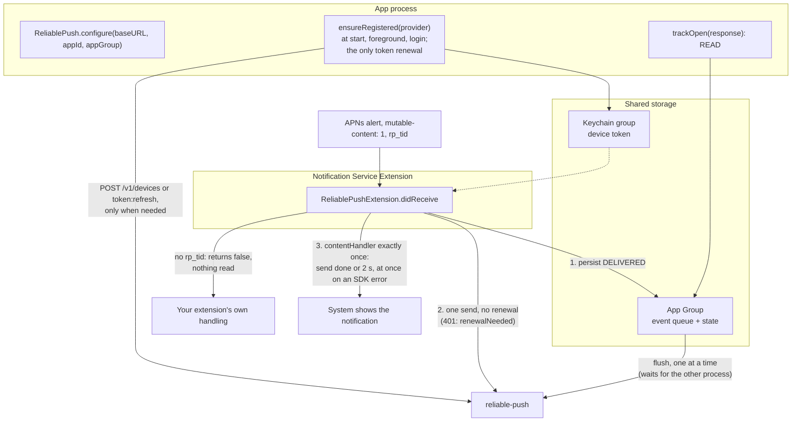

The extension calls the content handler exactly once: after the send, at the send timeout (`extensionSendTimeout`,
2 s by default; the settings read counts against it), or when iOS ends the extension, and at once when there is
nothing to send or an SDK step fails. It never renews the token: a `401` sets `renewalNeeded` in the App Group and the
app's next `ensureRegistered` acts on it. Reference: [ios.md](ios.md).

## 9. Harness and web console

The harness is a local test stack. It is never built into the backend image and never deployed. It runs the real
backend (one API, two workers) with simulated senders, devices and fallback receivers.

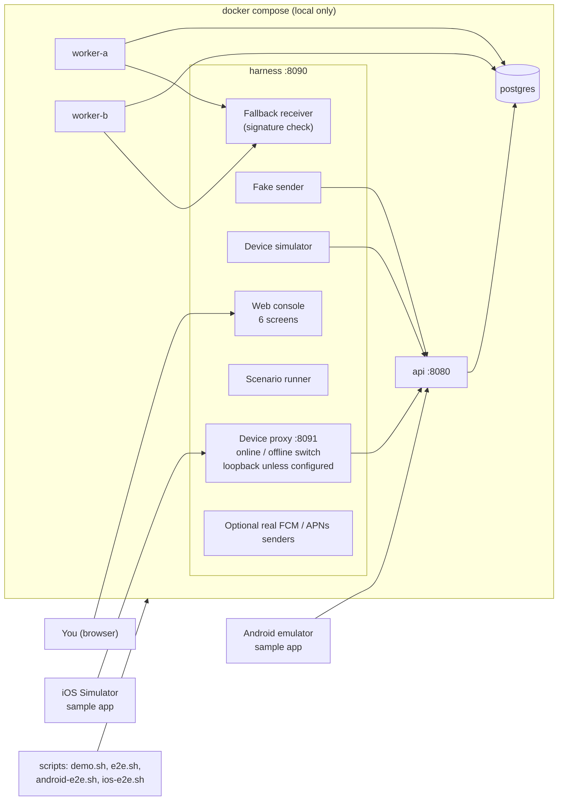

Reference: [testing.md](testing.md), [getting-started.md](getting-started.md).

## 10. Helm chart and deployment

The chart installs the backend only. PostgreSQL is yours (managed or operator). It runs **combined** (every pod is
API and worker) or **split** (API pods behind the Service, worker pods with no traffic).

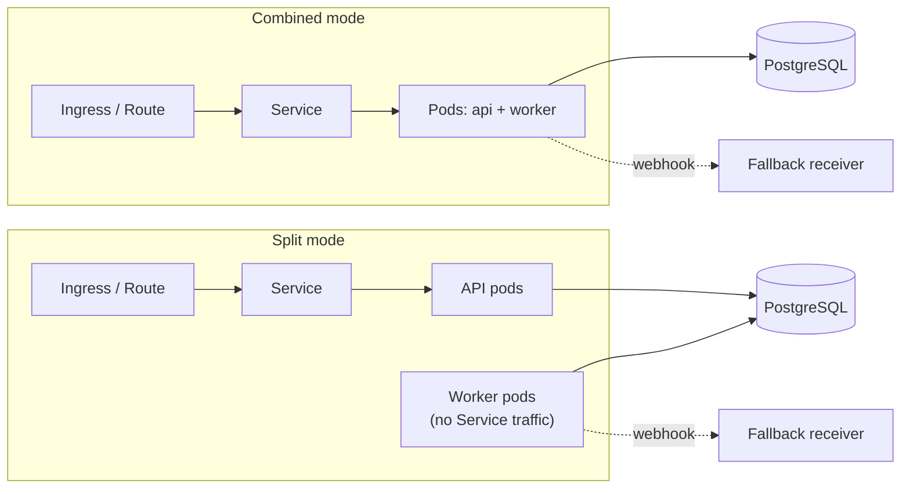

Values for GKE and OpenShift are included (non-root, arbitrary UID). Reference: [deployment.md](deployment.md).

## 11. Load tests

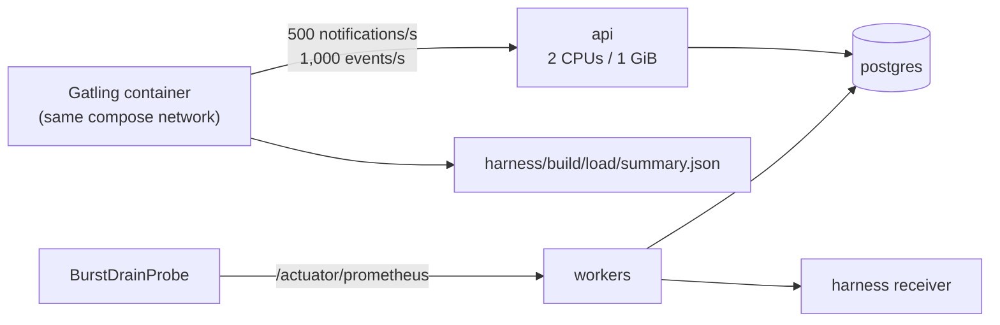

NFR-2 (at least 1,000 events/s per replica) was validated locally. Reference:
[operations.md, "Measured capacity"](operations.md#measured-capacity) and [testing.md](testing.md#load-tests-local-only).
